# Photo check

**1000** cars, **52** makes, 2 per row, alphabetical by make then model.

Generated — do not hand-edit. Re-run after any catalog change:

```bash
node scripts/make-photo-check.mjs
```

## What to look for

Each caption gives the production years and the body style, because those are the two things a wrong photo gets wrong while still looking fine:

- **Wrong generation.** A nameplate runs for decades and every version carries the same name. Check the bodywork against the years.
- **Wrong body.** Body Style is a live grid category, so an estate behind a `Sedan` record or a cabriolet behind a `Hatchback` one makes a real puzzle wrong. Ten of these were caught during the import waves.
- **Not a standard car.** Race or police livery, dealer decals, a roof box, a bull bar, or a performance variant standing in for the base car.

Quote the `car-id` under any tile that looks wrong. Rejecting one is:

```bash
node scripts/mark-image-verified.mjs --reject <car-id>
node scripts/apply-image-urls.mjs
node scripts/park-imageless-cars.mjs   # drops it out of the game
node scripts/validate-grids.mjs --min 3
```

## Makes

[Acura](#acura) 1 · [Alfa Romeo](#alfa-romeo) 1 · [Aston Martin](#aston-martin) 9 · [Audi](#audi) 13 · [Bentley](#bentley) 1 · [BMW](#bmw) 16 · [Bugatti](#bugatti) 1 · [Buick](#buick) 73 · [Cadillac](#cadillac) 61 · [Chevrolet](#chevrolet) 24 · [Citroën](#citron) 41 · [Dodge](#dodge) 16 · [Ferrari](#ferrari) 9 · [Fiat](#fiat) 55 · [Ford](#ford) 24 · [GMC](#gmc) 1 · [Holden](#holden) 31 · [Honda](#honda) 20 · [Hyundai](#hyundai) 9 · [Infiniti](#infiniti) 1 · [Jaguar](#jaguar) 9 · [Jeep](#jeep) 43 · [Kia](#kia) 9 · [Koenigsegg](#koenigsegg) 1 · [Lamborghini](#lamborghini) 9 · [Lancia](#lancia) 2 · [Land Rover](#land-rover) 1 · [Lexus](#lexus) 47 · [Lincoln](#lincoln) 1 · [Maserati](#maserati) 1 · [Mazda](#mazda) 8 · [McLaren](#mclaren) 8 · [Mercedes-Benz](#mercedes-benz) 9 · [MINI](#mini) 1 · [Mitsubishi](#mitsubishi) 61 · [Nissan](#nissan) 133 · [Pagani](#pagani) 1 · [Peugeot](#peugeot) 41 · [Plymouth](#plymouth) 1 · [Pontiac](#pontiac) 12 · [Porsche](#porsche) 9 · [Renault](#renault) 56 · [Rimac](#rimac) 2 · [Rivian](#rivian) 2 · [Rolls-Royce](#rolls-royce) 1 · [Skoda](#skoda) 32 · [Subaru](#subaru) 20 · [Tesla](#tesla) 5 · [Toyota](#toyota) 23 · [TVR](#tvr) 1 · [Volkswagen](#volkswagen) 9 · [Volvo](#volvo) 35

## Acura

1 car

| | |
|---|---|
| 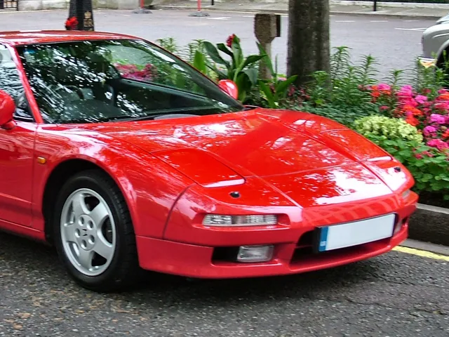<br>**Acura NSX**<br>1990–2005 · Coupe · Sports Car<br>`acura-nsx-g1` |  |

## Alfa Romeo

1 car

| | |
|---|---|
| 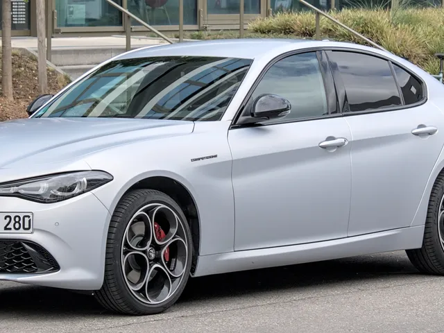<br>**Alfa Romeo Giulia Quadrifoglio**<br>2016–now · Sedan · Sedan<br>`alfa-romeo-giulia-quadrifoglio-g1` |  |

## Aston Martin

9 cars

| | |
|---|---|
| 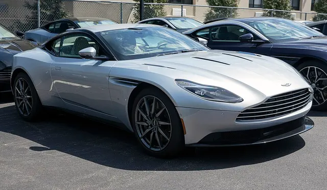<br>**Aston Martin DB11**<br>2016–2023 · Coupe · Coupe<br>`aston-martin-db11-g1` | 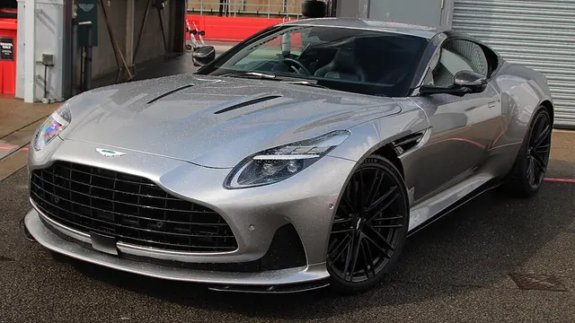<br>**Aston Martin DB12**<br>2023–now · Coupe · Coupe<br>`aston-martin-db12-g1` |
| <br>**Aston Martin DB5**<br>1963–1965 · Coupe · Coupe<br>`aston-martin-db5-g1` | 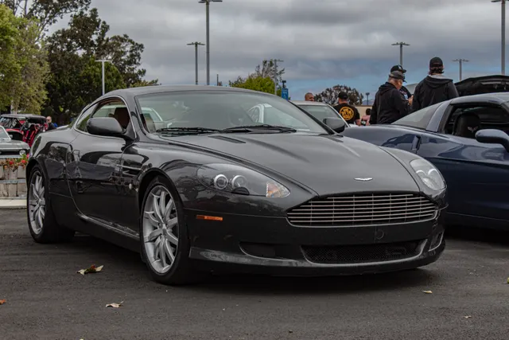<br>**Aston Martin DB9**<br>2004–2016 · Coupe · Coupe<br>`aston-martin-db9-g1` |
| 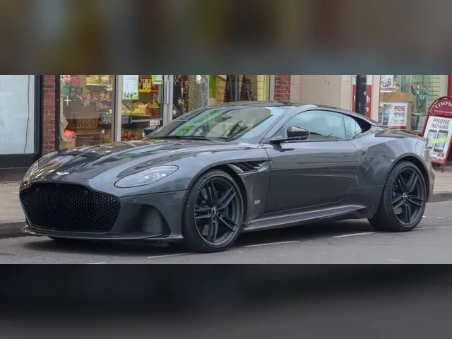<br>**Aston Martin DBS**<br>2018–2024 · Coupe · Coupe<br>`aston-martin-dbs-g3` | 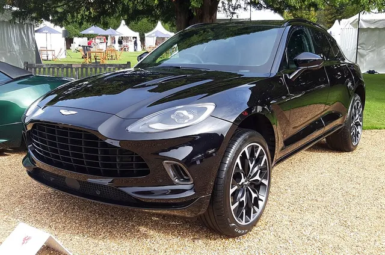<br>**Aston Martin DBX**<br>2020–now · SUV · SUV<br>`aston-martin-dbx-g1` |
| 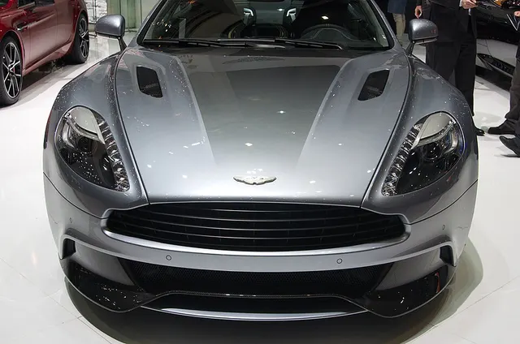<br>**Aston Martin Vanquish**<br>2012–2018 · Coupe · Coupe<br>`aston-martin-vanquish-g2` | 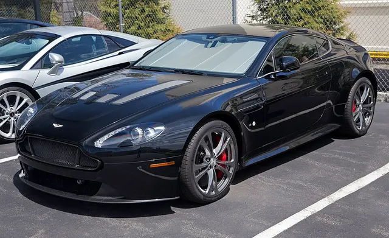<br>**Aston Martin Vantage** · Gen 1<br>2005–2017 · Coupe · Sports Car<br>`aston-martin-vantage-g1` |
| 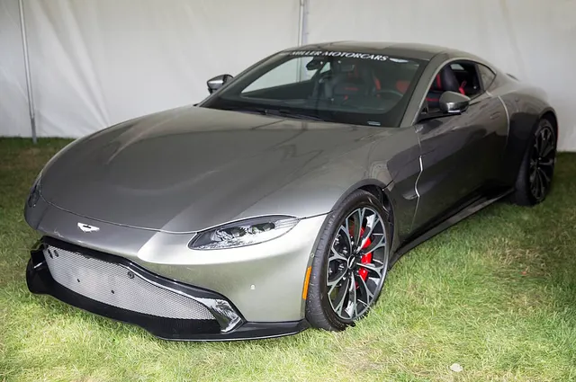<br>**Aston Martin Vantage** · Gen 2<br>2018–2024 · Coupe · Sports Car<br>`aston-martin-vantage-g2` |  |

## Audi

13 cars

| | |
|---|---|
| 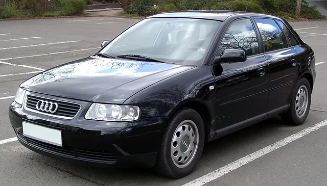<br>**Audi A3**<br>1996–2003 · Hatchback · Hatchback<br>`audi-a3-g1` | 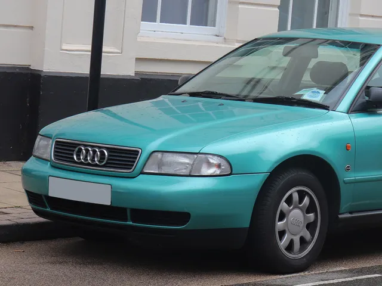<br>**Audi A4**<br>1994–2001 · Sedan · Sedan<br>`audi-a4-g1` |
| 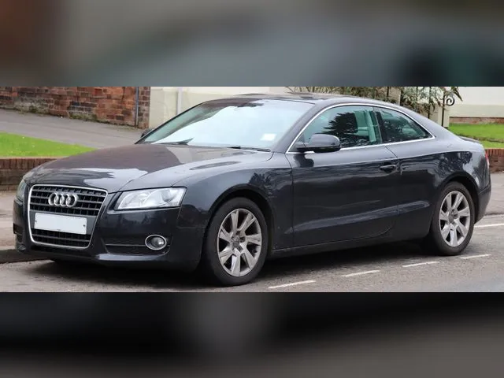<br>**Audi A5**<br>2007–2016 · Coupe · Coupe<br>`audi-a5-g1` | 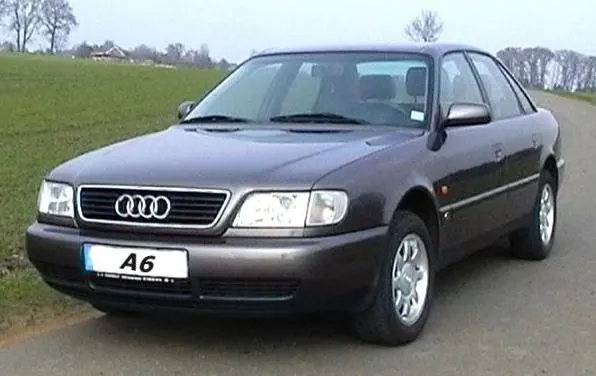<br>**Audi A6**<br>1994–1997 · Sedan · Sedan<br>`audi-a6-g1` |
| 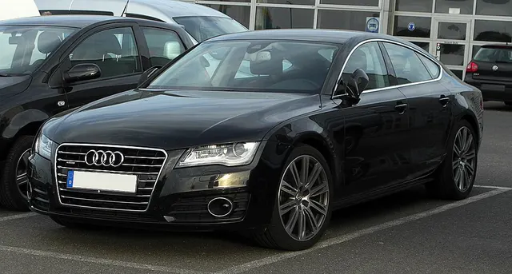<br>**Audi A7**<br>2010–2018 · Sedan · Sedan<br>`audi-a7-g1` | 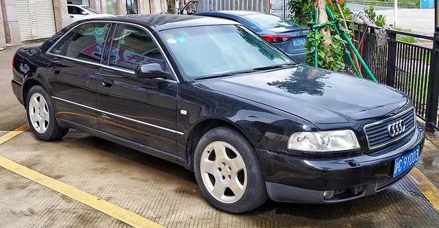<br>**Audi A8**<br>1994–2002 · Sedan · Sedan<br>`audi-a8-g1` |
| 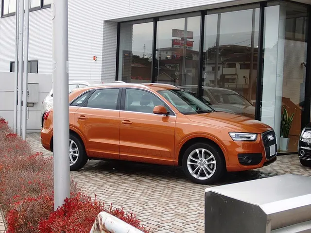<br>**Audi Q3**<br>2011–2018 · SUV · SUV<br>`audi-q3-g1` | 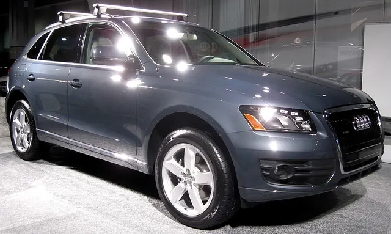<br>**Audi Q5**<br>2008–2017 · SUV · SUV<br>`audi-q5-g1` |
| 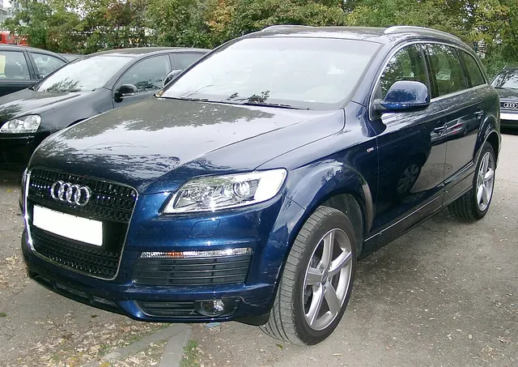<br>**Audi Q7**<br>2006–2015 · SUV · SUV<br>`audi-q7-g1` | 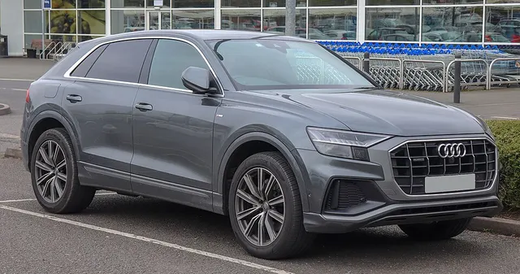<br>**Audi Q8**<br>2018–now · SUV · SUV<br>`audi-q8-g1` |
| 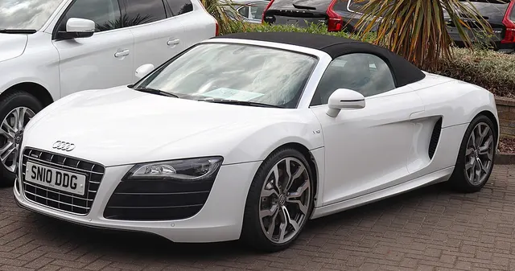<br>**Audi R8**<br>2006–2015 · Coupe · Supercar<br>`audi-r8-g1` | 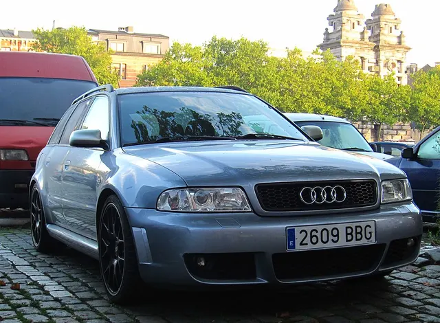<br>**Audi RS 4 Avant**<br>1999–2001 · Wagon · Wagon<br>`audi-rs4-avant-g1` |
| 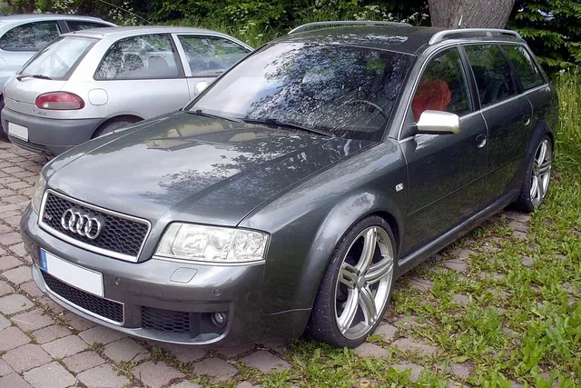<br>**Audi RS 6 Avant**<br>2002–2004 · Wagon · Wagon<br>`audi-rs6-avant-g1` |  |

## Bentley

1 car

| | |
|---|---|
| 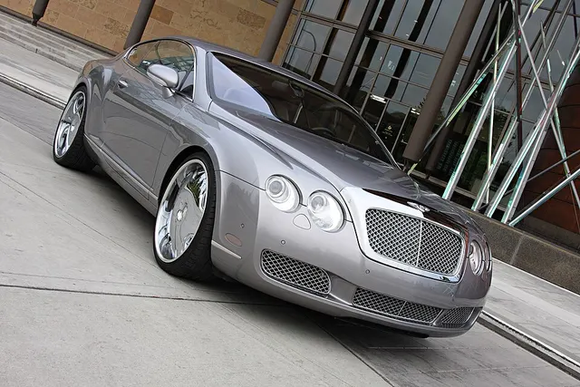<br>**Bentley Continental GT**<br>2003–2010 · Coupe · Coupe<br>`bentley-continental-gt-g1` |  |

## BMW

16 cars

| | |
|---|---|
| 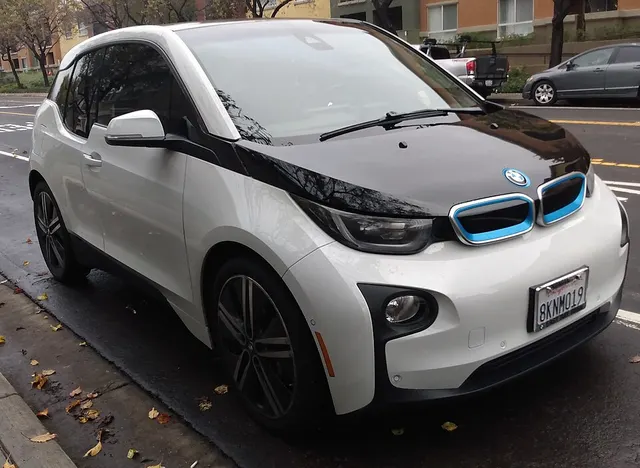<br>**BMW i3**<br>2013–2022 · Hatchback · Hatchback<br>`bmw-i3-g1` | 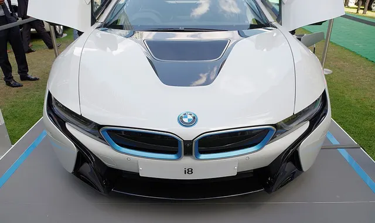<br>**BMW i8**<br>2014–2020 · Coupe · Sports Car<br>`bmw-i8-g1` |
| 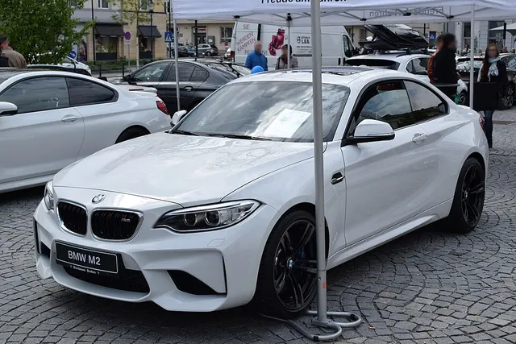<br>**BMW M2**<br>2016–2020 · Coupe · Sports Car<br>`bmw-m2-g1` | 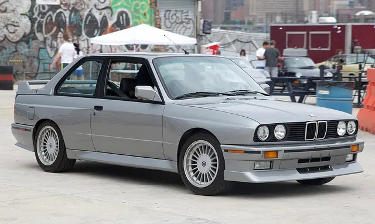<br>**BMW M3**<br>1986–1991 · Coupe · Sports Car<br>`bmw-m3-g1` |
| 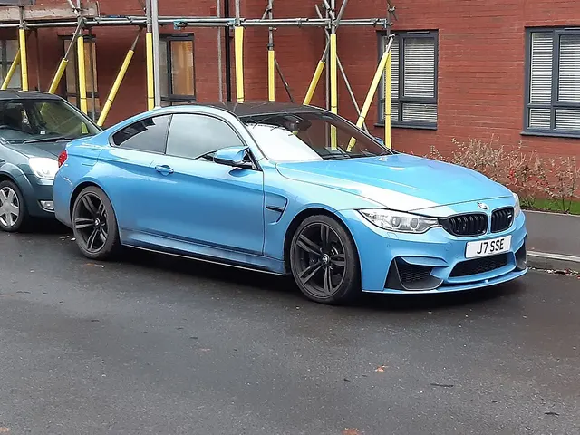<br>**BMW M4**<br>2014–2020 · Coupe · Sports Car<br>`bmw-m4-g1` | 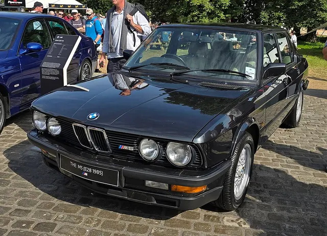<br>**BMW M5**<br>1984–1988 · Sedan · Sports Car<br>`bmw-m5-g1` |
| 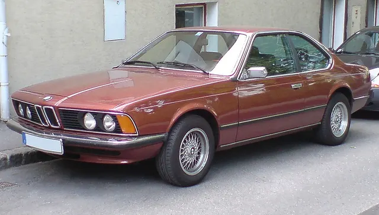<br>**BMW M6**<br>1983–1989 · Coupe · Sports Car<br>`bmw-m6-g1` | 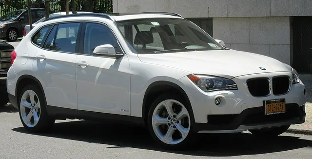<br>**BMW X1**<br>2009–2015 · SUV · SUV<br>`bmw-x1-g1` |
| 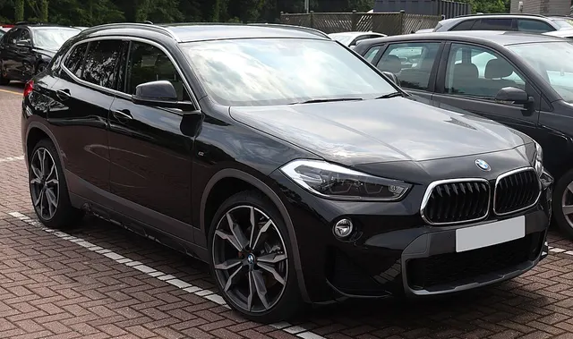<br>**BMW X2**<br>2018–2023 · SUV · SUV<br>`bmw-x2-g1` | 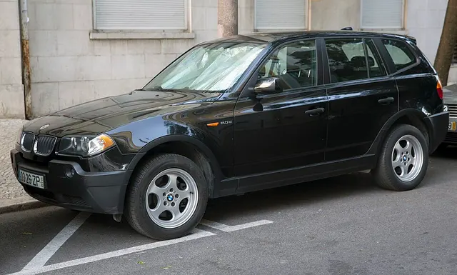<br>**BMW X3**<br>2004–2010 · SUV · SUV<br>`bmw-x3-g1` |
| 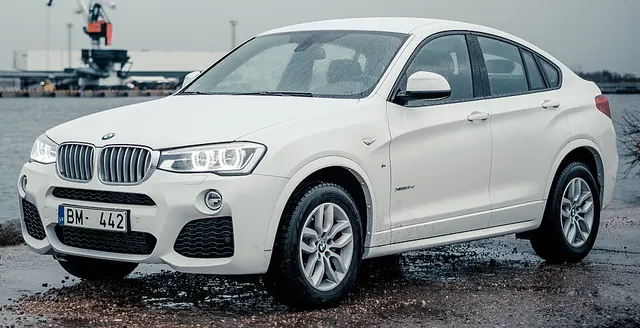<br>**BMW X4**<br>2014–2018 · SUV · SUV<br>`bmw-x4-g1` | 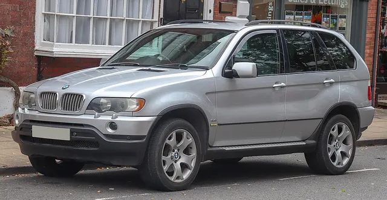<br>**BMW X5**<br>2000–2006 · SUV · SUV<br>`bmw-x5-g1` |
| 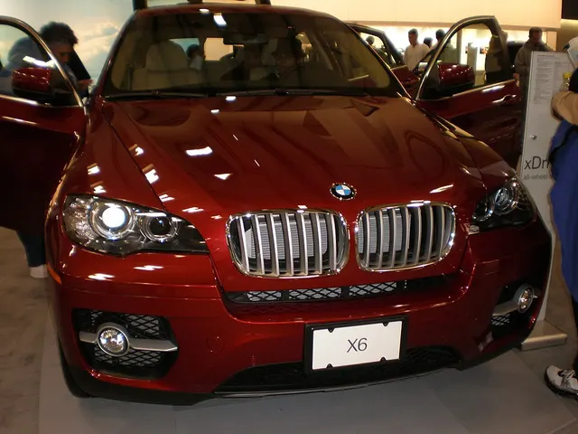<br>**BMW X6**<br>2008–2014 · SUV · SUV<br>`bmw-x6-g1` | <br>**BMW X7**<br>2019–now · SUV · SUV<br>`bmw-x7-g1` |
| 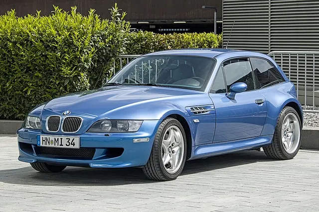<br>**BMW Z3**<br>1996–2002 · Convertible · Sports Car<br>`bmw-z3-g1` | 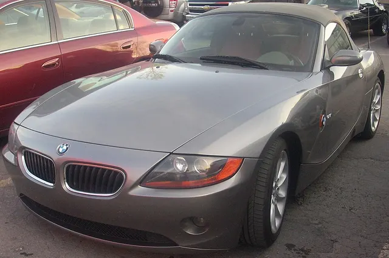<br>**BMW Z4**<br>2003–2008 · Convertible · Sports Car<br>`bmw-z4-g1` |

## Bugatti

1 car

| | |
|---|---|
| 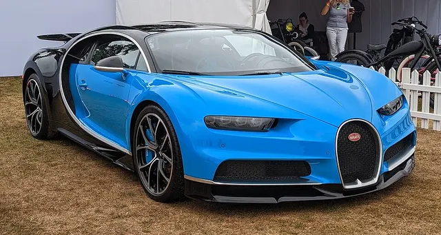<br>**Bugatti Chiron**<br>2016–2024 · Coupe · Hypercar<br>`bugatti-chiron-g1` |  |

## Buick

73 cars

| | |
|---|---|
| 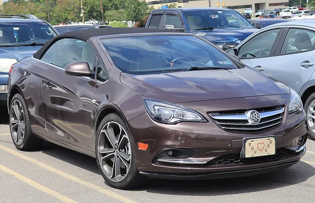<br>**Buick Cascada**<br>2016–2019 · Convertible · Coupe<br>`buick-cascada-g1` | 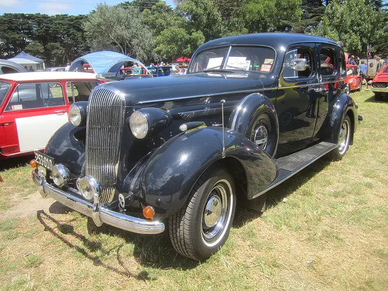<br>**Buick Century** · Gen 1<br>1936–1942 · Sedan · Sedan<br>`buick-century-g1` |
| 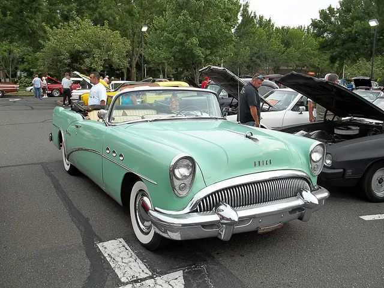<br>**Buick Century** · Gen 2<br>1954–1958 · Sedan · Sedan<br>`buick-century-g2` | 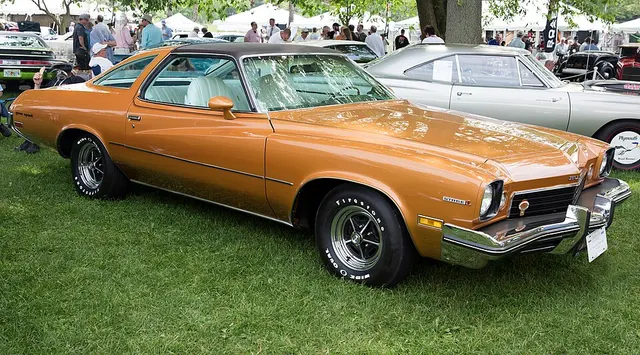<br>**Buick Century** · Gen 3<br>1973–1977 · Sedan · Sedan<br>`buick-century-g3` |
| 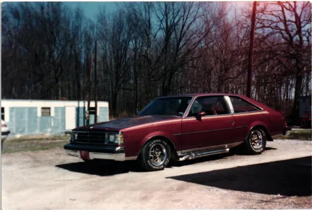<br>**Buick Century** · Gen 4<br>1978–1981 · Sedan · Sedan<br>`buick-century-g4` | 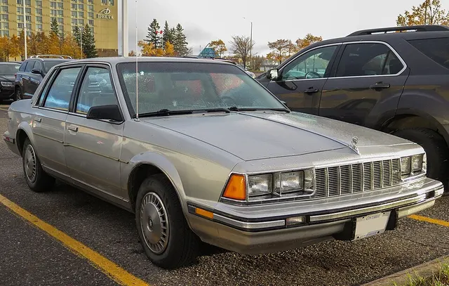<br>**Buick Century** · Gen 5<br>1982–1996 · Sedan · Sedan<br>`buick-century-g5` |
| 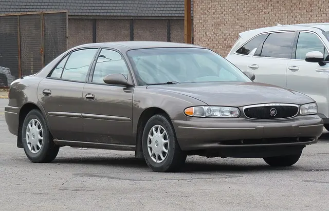<br>**Buick Century** · Gen 6<br>1997–2005 · Sedan · Sedan<br>`buick-century-g6` | 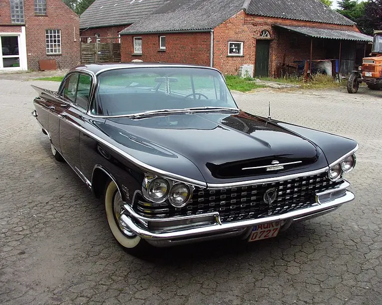<br>**Buick Electra** · Gen 1<br>1959–1960 · Sedan · Sedan<br>`buick-electra-g1` |
| 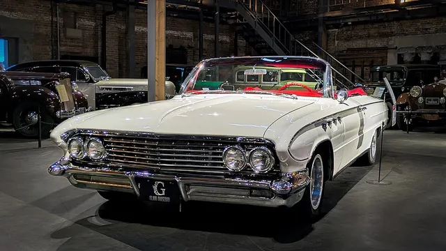<br>**Buick Electra** · Gen 2<br>1961–1964 · Sedan · Sedan<br>`buick-electra-g2` | 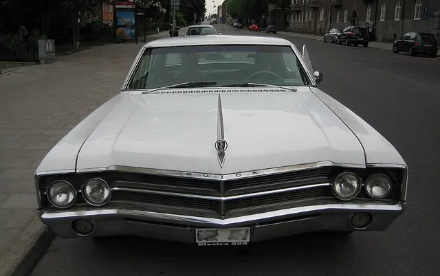<br>**Buick Electra** · Gen 3<br>1965–1970 · Sedan · Sedan<br>`buick-electra-g3` |
| <br>**Buick Electra** · Gen 4<br>1971–1976 · Sedan · Sedan<br>`buick-electra-g4` | <br>**Buick Electra** · Gen 5<br>1977–1984 · Sedan · Sedan<br>`buick-electra-g5` |
| <br>**Buick Electra** · Gen 6<br>1985–1990 · Sedan · Sedan<br>`buick-electra-g6` | <br>**Buick Electra E5**<br>2023–now · SUV · SUV<br>`buick-electra-e5-g1` |
| <br>**Buick Enclave** · Gen 1<br>2008–2017 · SUV · SUV<br>`buick-enclave-g1` | <br>**Buick Enclave** · Gen 2<br>2018–2024 · SUV · SUV<br>`buick-enclave-g2` |
| <br>**Buick Enclave** · Gen 3<br>2025–now · SUV · SUV<br>`buick-enclave-g3` | <br>**Buick Encore**<br>2013–2022 · SUV · SUV<br>`buick-encore-g1` |
| <br>**Buick Encore GX**<br>2020–now · SUV · SUV<br>`buick-encore-gx-g1` | <br>**Buick Envision** · Gen 1<br>2016–2020 · SUV · SUV<br>`buick-envision-g1` |
| <br>**Buick Envision** · Gen 2<br>2021–2025 · SUV · SUV<br>`buick-envision-g2` | <br>**Buick Envista**<br>2024–now · SUV · SUV<br>`buick-envista-g1` |
| <br>**Buick Gran Sport / GS**<br>1965–1975 · Coupe · Muscle Car<br>`buick-gran-sport-gs-g1` | <br>**Buick Invicta**<br>1959–1963 · Sedan · Sedan<br>`buick-invicta-g1` |
| <br>**Buick LaCrosse** · Gen 1<br>2005–2009 · Sedan · Sedan<br>`buick-lacrosse-g1` | <br>**Buick LaCrosse** · Gen 2<br>2010–2016 · Sedan · Sedan<br>`buick-lacrosse-g2` |
| <br>**Buick LaCrosse** · Gen 3<br>2017–2019 · Sedan · Sedan<br>`buick-lacrosse-g3` | <br>**Buick LeSabre** · Gen 1<br>1959–1960 · Sedan · Sedan<br>`buick-lesabre-g1` |
| <br>**Buick LeSabre** · Gen 2<br>1961–1964 · Sedan · Sedan<br>`buick-lesabre-g2` | <br>**Buick LeSabre** · Gen 3<br>1965–1970 · Sedan · Sedan<br>`buick-lesabre-g3` |
| <br>**Buick LeSabre** · Gen 4<br>1971–1976 · Sedan · Sedan<br>`buick-lesabre-g4` | <br>**Buick LeSabre** · Gen 5<br>1977–1985 · Sedan · Sedan<br>`buick-lesabre-g5` |
| <br>**Buick LeSabre** · Gen 6<br>1986–1991 · Sedan · Sedan<br>`buick-lesabre-g6` | <br>**Buick LeSabre** · Gen 7<br>1992–1999 · Sedan · Sedan<br>`buick-lesabre-g7` |
| <br>**Buick LeSabre** · Gen 8<br>2000–2005 · Sedan · Sedan<br>`buick-lesabre-g8` | <br>**Buick Lucerne**<br>2006–2011 · Sedan · Sedan<br>`buick-lucerne-g1` |
| <br>**Buick Park Avenue** · Gen 1<br>1991–1996 · Sedan · Sedan<br>`buick-park-avenue-g1` | <br>**Buick Park Avenue** · Gen 2<br>1997–2005 · Sedan · Sedan<br>`buick-park-avenue-g2` |
| <br>**Buick Rainier**<br>2004–2007 · SUV · SUV<br>`buick-rainier-g1` | <br>**Buick Reatta**<br>1988–1991 · Coupe · Coupe<br>`buick-reatta-g1` |
| <br>**Buick Regal** · Gen 1<br>1973–1977 · Coupe · Coupe<br>`buick-regal-g1` | <br>**Buick Regal** · Gen 2<br>1978–1987 · Coupe · Coupe<br>`buick-regal-g2` |
| <br>**Buick Regal** · Gen 3<br>1988–1996 · Sedan · Sedan<br>`buick-regal-g3` | <br>**Buick Regal** · Gen 4<br>1997–2004 · Sedan · Sedan<br>`buick-regal-g4` |
| <br>**Buick Regal** · Gen 5<br>2011–2017 · Sedan · Sedan<br>`buick-regal-g5` | <br>**Buick Regal** · Gen 6<br>2018–2020 · Hatchback · Sedan<br>`buick-regal-g6` |
| <br>**Buick Regal GNX**<br>1987–1987 · Coupe · Muscle Car<br>`buick-regal-gnx-g1` | <br>**Buick Regal Grand National**<br>1982–1987 · Coupe · Muscle Car<br>`buick-regal-grand-national-g1` |
| <br>**Buick Rendezvous**<br>2002–2007 · SUV · SUV<br>`buick-rendezvous-g1` | <br>**Buick Riviera** · Gen 1<br>1963–1965 · Coupe · Coupe<br>`buick-riviera-g1` |
| <br>**Buick Riviera** · Gen 2<br>1966–1970 · Coupe · Coupe<br>`buick-riviera-g2` | <br>**Buick Riviera** · Gen 3<br>1971–1973 · Coupe · Coupe<br>`buick-riviera-g3` |
| <br>**Buick Riviera** · Gen 4<br>1974–1976 · Coupe · Coupe<br>`buick-riviera-g4` | <br>**Buick Riviera** · Gen 5<br>1977–1978 · Coupe · Coupe<br>`buick-riviera-g5` |
| <br>**Buick Riviera** · Gen 6<br>1979–1985 · Coupe · Coupe<br>`buick-riviera-g6` | <br>**Buick Riviera** · Gen 7<br>1986–1993 · Coupe · Coupe<br>`buick-riviera-g7` |
| <br>**Buick Riviera** · Gen 8<br>1995–1999 · Coupe · Coupe<br>`buick-riviera-g8` | <br>**Buick Roadmaster** · Gen 1<br>1936–1958 · Sedan · Sedan<br>`buick-roadmaster-g1` |
| <br>**Buick Roadmaster** · Gen 2<br>1991–1996 · Sedan · Sedan<br>`buick-roadmaster-g2` | <br>**Buick Skylark** · Gen 1<br>1953–1954 · Convertible · Coupe<br>`buick-skylark-g1` |
| <br>**Buick Skylark** · Gen 2<br>1961–1963 · Coupe · Coupe<br>`buick-skylark-g2` | <br>**Buick Skylark** · Gen 3<br>1964–1972 · Coupe · Coupe<br>`buick-skylark-g3` |
| <br>**Buick Skylark** · Gen 4<br>1975–1979 · Coupe · Coupe<br>`buick-skylark-g4` | <br>**Buick Skylark** · Gen 5<br>1980–1985 · Sedan · Sedan<br>`buick-skylark-g5` |
| <br>**Buick Skylark** · Gen 6<br>1986–1991 · Sedan · Sedan<br>`buick-skylark-g6` | <br>**Buick Skylark** · Gen 7<br>1992–1998 · Sedan · Sedan<br>`buick-skylark-g7` |
| <br>**Buick Somerset**<br>1985–1987 · Coupe · Coupe<br>`buick-somerset-g1` | <br>**Buick Special** · Gen 1<br>1936–1958 · Sedan · Sedan<br>`buick-special-g1` |
| <br>**Buick Special** · Gen 2<br>1961–1969 · Sedan · Sedan<br>`buick-special-g2` | <br>**Buick Super**<br>1940–1958 · Sedan · Sedan<br>`buick-super-g1` |
| <br>**Buick Terraza**<br>2005–2007 · Minivan · Minivan<br>`buick-terraza-g1` | <br>**Buick Verano**<br>2012–2017 · Sedan · Sedan<br>`buick-verano-g1` |
| <br>**Buick Wildcat**<br>1962–1970 · Coupe · Coupe<br>`buick-wildcat-g1` |  |

## Cadillac

61 cars

| | |
|---|---|
| <br>**Cadillac Allanté**<br>1987–1993 · Convertible · Sports Car<br>`cadillac-allante-g1` | <br>**Cadillac ATS**<br>2013–2019 · Sedan · Sedan<br>`cadillac-ats-g1` |
| <br>**Cadillac ATS-V**<br>2016–2019 · Sedan · Sedan<br>`cadillac-ats-v-g1` | <br>**Cadillac Calais**<br>1965–1976 · Sedan · Sedan<br>`cadillac-calais-g1` |
| <br>**Cadillac Catera**<br>1997–2001 · Sedan · Sedan<br>`cadillac-catera-g1` | <br>**Cadillac Celestiq**<br>2024–now · Sedan · Sedan<br>`cadillac-celestiq-g1` |
| <br>**Cadillac Cimarron**<br>1982–1988 · Sedan · Sedan<br>`cadillac-cimarron-g1` | <br>**Cadillac CT4**<br>2020–now · Sedan · Sedan<br>`cadillac-ct4-g1` |
| <br>**Cadillac CT4-V Blackwing**<br>2022–now · Sedan · Sedan<br>`cadillac-ct4-v-blackwing-g1` | <br>**Cadillac CT5**<br>2020–now · Sedan · Sedan<br>`cadillac-ct5-g1` |
| <br>**Cadillac CT5-V Blackwing**<br>2022–now · Sedan · Sedan<br>`cadillac-ct5-v-blackwing-g1` | <br>**Cadillac CT6**<br>2016–2020 · Sedan · Sedan<br>`cadillac-ct6-g1` |
| <br>**Cadillac CTS** · Gen 1<br>2003–2007 · Sedan · Sedan<br>`cadillac-cts-g1` | <br>**Cadillac CTS** · Gen 2<br>2008–2014 · Sedan · Sedan<br>`cadillac-cts-g2` |
| <br>**Cadillac CTS-V** · Gen 1<br>2004–2007 · Sedan · Sedan<br>`cadillac-cts-v-g1` | <br>**Cadillac CTS-V** · Gen 2<br>2009–2014 · Sedan · Sedan<br>`cadillac-cts-v-g2` |
| <br>**Cadillac CTS-V** · Gen 3<br>2016–2019 · Sedan · Sedan<br>`cadillac-cts-v-g3` | <br>**Cadillac De Ville** · Gen 1<br>1959–1964 · Sedan · Sedan<br>`cadillac-de-ville-g1` |
| <br>**Cadillac De Ville** · Gen 2<br>1965–1970 · Sedan · Sedan<br>`cadillac-de-ville-g2` | <br>**Cadillac De Ville** · Gen 3<br>1971–1976 · Sedan · Sedan<br>`cadillac-de-ville-g3` |
| <br>**Cadillac De Ville** · Gen 4<br>1977–1984 · Sedan · Sedan<br>`cadillac-de-ville-g4` | <br>**Cadillac De Ville** · Gen 5<br>1985–1993 · Sedan · Sedan<br>`cadillac-de-ville-g5` |
| <br>**Cadillac DeVille** · Gen 6<br>1994–1999 · Sedan · Sedan<br>`cadillac-deville-g6` | <br>**Cadillac DeVille** · Gen 7<br>2000–2005 · Sedan · Sedan<br>`cadillac-deville-g7` |
| <br>**Cadillac DTS**<br>2006–2011 · Sedan · Sedan<br>`cadillac-dts-g1` | <br>**Cadillac Eldorado** · Gen 2<br>1954–1956 · Convertible · Coupe<br>`cadillac-eldorado-g2` |
| <br>**Cadillac Eldorado** · Gen 3<br>1957–1958 · Convertible · Coupe<br>`cadillac-eldorado-g3` | <br>**Cadillac Eldorado** · Gen 4<br>1959–1960 · Convertible · Coupe<br>`cadillac-eldorado-g4` |
| <br>**Cadillac Eldorado** · Gen 5<br>1961–1966 · Convertible · Coupe<br>`cadillac-eldorado-g5` | <br>**Cadillac Eldorado** · Gen 6<br>1967–1970 · Coupe · Coupe<br>`cadillac-eldorado-g6` |
| <br>**Cadillac Eldorado** · Gen 7<br>1971–1978 · Convertible · Coupe<br>`cadillac-eldorado-g7` | <br>**Cadillac Eldorado** · Gen 8<br>1979–1985 · Coupe · Coupe<br>`cadillac-eldorado-g8` |
| <br>**Cadillac Eldorado** · Gen 9<br>1986–1991 · Coupe · Coupe<br>`cadillac-eldorado-g9` | <br>**Cadillac Eldorado** · Gen 10<br>1992–2002 · Coupe · Coupe<br>`cadillac-eldorado-g10` |
| <br>**Cadillac ELR**<br>2014–2016 · Coupe · Coupe<br>`cadillac-elr-g1` | <br>**Cadillac Escalade** · Gen 1<br>1999–2000 · SUV · SUV<br>`cadillac-escalade-g1` |
| <br>**Cadillac Escalade** · Gen 2<br>2002–2006 · SUV · SUV<br>`cadillac-escalade-g2` | <br>**Cadillac Escalade** · Gen 3<br>2007–2014 · SUV · SUV<br>`cadillac-escalade-g3` |
| <br>**Cadillac Escalade** · Gen 4<br>2015–2020 · SUV · SUV<br>`cadillac-escalade-g4` | <br>**Cadillac Escalade** · Gen 5<br>2021–now · SUV · SUV<br>`cadillac-escalade-g5` |
| <br>**Cadillac Escalade IQ**<br>2025–now · SUV · SUV<br>`cadillac-escalade-iq-g1` | <br>**Cadillac Fleetwood** · Gen 1<br>1985–1992 · Sedan · Sedan<br>`cadillac-fleetwood-g1` |
| <br>**Cadillac Fleetwood** · Gen 2<br>1993–1996 · Sedan · Sedan<br>`cadillac-fleetwood-g2` | <br>**Cadillac Fleetwood Brougham**<br>1977–1992 · Sedan · Sedan<br>`cadillac-fleetwood-brougham-g1` |
| <br>**Cadillac Lyriq**<br>2023–now · SUV · SUV<br>`cadillac-lyriq-g1` | <br>**Cadillac Optiq**<br>2025–now · SUV · SUV<br>`cadillac-optiq-g1` |
| <br>**Cadillac Series 62**<br>1940–1964 · Sedan · Sedan<br>`cadillac-series-62-g1` | <br>**Cadillac Seville** · Gen 1<br>1975–1979 · Sedan · Sedan<br>`cadillac-seville-g1` |
| <br>**Cadillac Seville** · Gen 2<br>1980–1985 · Sedan · Sedan<br>`cadillac-seville-g2` | <br>**Cadillac Seville** · Gen 3<br>1986–1991 · Sedan · Sedan<br>`cadillac-seville-g3` |
| <br>**Cadillac Seville** · Gen 4<br>1992–1997 · Sedan · Sedan<br>`cadillac-seville-g4` | <br>**Cadillac Seville** · Gen 5<br>1998–2004 · Sedan · Sedan<br>`cadillac-seville-g5` |
| <br>**Cadillac SRX** · Gen 1<br>2004–2009 · SUV · SUV<br>`cadillac-srx-g1` | <br>**Cadillac SRX** · Gen 2<br>2010–2016 · SUV · SUV<br>`cadillac-srx-g2` |
| <br>**Cadillac STS**<br>2005–2011 · Sedan · Sedan<br>`cadillac-sts-g1` | <br>**Cadillac Vistiq**<br>2026–now · SUV · SUV<br>`cadillac-vistiq-g1` |
| <br>**Cadillac XLR**<br>2004–2009 · Convertible · Sports Car<br>`cadillac-xlr-g1` | <br>**Cadillac XT4**<br>2019–2025 · SUV · SUV<br>`cadillac-xt4-g1` |
| <br>**Cadillac XT5**<br>2017–now · SUV · SUV<br>`cadillac-xt5-g1` | <br>**Cadillac XT6**<br>2020–2025 · SUV · SUV<br>`cadillac-xt6-g1` |
| <br>**Cadillac XTS**<br>2013–2019 · Sedan · Sedan<br>`cadillac-xts-g1` |  |

## Chevrolet

24 cars

| | |
|---|---|
| <br>**Chevrolet Blazer**<br>1969–1972 · SUV · SUV<br>`chevrolet-blazer-g1` | <br>**Chevrolet Bolt EV**<br>2017–2023 · Hatchback · Hatchback<br>`chevrolet-bolt-ev-g1` |
| <br>**Chevrolet Camaro** · Gen 1<br>1967–1969 · Coupe · Muscle Car<br>`chevrolet-camaro-g1` | <br>**Chevrolet Camaro** · Gen 4<br>1993–2002 · Coupe · Muscle Car<br>`chevrolet-camaro-g4` |
| <br>**Chevrolet Camaro** · Gen 5<br>2010–2015 · Coupe · Muscle Car<br>`chevrolet-camaro-g5` | <br>**Chevrolet Camaro** · Gen 6<br>2016–2024 · Coupe · Muscle Car<br>`chevrolet-camaro-g6` |
| <br>**Chevrolet Chevelle**<br>1968–1972 · Coupe · Muscle Car<br>`chevrolet-chevelle-g2` | <br>**Chevrolet Cobalt**<br>2005–2010 · Sedan · Sedan<br>`chevrolet-cobalt-g1` |
| <br>**Chevrolet Colorado**<br>2004–2012 · Pickup Truck · Pickup Truck<br>`chevrolet-colorado-g1` | <br>**Chevrolet Corvette**<br>1953–1962 · Convertible · Sports Car<br>`chevrolet-corvette-g1` |
| <br>**Chevrolet Cruze**<br>2008–2016 · Sedan · Sedan<br>`chevrolet-cruze-g1` | <br>**Chevrolet Equinox**<br>2005–2009 · SUV · SUV<br>`chevrolet-equinox-g1` |
| <br>**Chevrolet Express**<br>1996–now · Minivan · Minivan<br>`chevrolet-express-g1` | <br>**Chevrolet HHR**<br>2006–2011 · Wagon · Wagon<br>`chevrolet-hhr-g1` |
| <br>**Chevrolet Impala**<br>1958–1958 · Coupe · Coupe<br>`chevrolet-impala-g1` | <br>**Chevrolet Malibu**<br>1964–1967 · Coupe · Muscle Car<br>`chevrolet-malibu-g1` |
| <br>**Chevrolet Nova**<br>1968–1974 · Coupe · Muscle Car<br>`chevrolet-nova-g3` | <br>**Chevrolet Silverado**<br>1999–2006 · Pickup Truck · Pickup Truck<br>`chevrolet-silverado-g1` |
| <br>**Chevrolet SSR**<br>2003–2006 · Pickup Truck · Pickup Truck<br>`chevrolet-ssr-g1` | <br>**Chevrolet Suburban**<br>1935–1940 · SUV · SUV<br>`chevrolet-suburban-g1` |
| <br>**Chevrolet Tahoe**<br>1995–1999 · SUV · SUV<br>`chevrolet-tahoe-g1` | <br>**Chevrolet Trailblazer**<br>2002–2009 · SUV · SUV<br>`chevrolet-trailblazer-g1` |
| <br>**Chevrolet Traverse**<br>2009–2017 · SUV · SUV<br>`chevrolet-traverse-g1` | <br>**Chevrolet Trax**<br>2013–2022 · SUV · SUV<br>`chevrolet-trax-g1` |

## Citroën

41 cars

| | |
|---|---|
| <br>**Citroën 2CV**<br>1948–1990 · Sedan · Sedan<br>`citroen-2cv-g1` | <br>**Citroën Ami**<br>2020–now · Hatchback · Hatchback<br>`citroen-ami-g2` |
| <br>**Citroën AX**<br>1986–1998 · Hatchback · Hatchback<br>`citroen-ax-g1` | <br>**Citroën Berlingo**<br>2018–now · Minivan · Minivan<br>`citroen-berlingo-g3` |
| <br>**Citroën BX**<br>1982–1994 · Hatchback · Hatchback<br>`citroen-bx-g1` | <br>**Citroën C1**<br>2014–2022 · Hatchback · Hatchback<br>`citroen-c1-g2` |
| <br>**Citroën C2**<br>2003–2009 · Hatchback · Hatchback<br>`citroen-c2-g1` | <br>**Citroën C3** · Gen 1<br>2002–2009 · Hatchback · Hatchback<br>`citroen-c3-g1` |
| <br>**Citroën C3** · Gen 2<br>2009–2016 · Hatchback · Hatchback<br>`citroen-c3-g2` | <br>**Citroën C3** · Gen 3<br>2016–2024 · Hatchback · Hatchback<br>`citroen-c3-g3` |
| <br>**Citroën C3 Aircross** · Gen 1<br>2017–2024 · SUV · SUV<br>`citroen-c3-aircross-g1` | <br>**Citroën C3 Aircross** · Gen 2<br>2024–now · SUV · SUV<br>`citroen-c3-aircross-g2` |
| <br>**Citroën C4** · Gen 2<br>2010–2018 · Hatchback · Hatchback<br>`citroen-c4-g2` | <br>**Citroën C4** · Gen 3<br>2020–now · Hatchback · Hatchback<br>`citroen-c4-g3` |
| <br>**Citroën C4 Cactus**<br>2014–2020 · Hatchback · Hatchback<br>`citroen-c4-cactus-g1` | <br>**Citroën C4 Picasso**<br>2006–2013 · Minivan · Minivan<br>`citroen-c4-picasso-g1` |
| <br>**Citroën C4 Picasso / SpaceTourer**<br>2013–2022 · Minivan · Minivan<br>`citroen-c4-picasso-spacetourer-g2` | <br>**Citroën C5** · Gen 1<br>2001–2008 · Hatchback · Sedan<br>`citroen-c5-g1` |
| <br>**Citroën C5** · Gen 2<br>2008–2017 · Sedan · Sedan<br>`citroen-c5-g2` | <br>**Citroën C5 Aircross** · Gen 1<br>2018–2025 · SUV · SUV<br>`citroen-c5-aircross-g1` |
| <br>**Citroën C5 Aircross** · Gen 2<br>2025–now · SUV · SUV<br>`citroen-c5-aircross-g2` | <br>**Citroën C5 X**<br>2021–now · Hatchback · Sedan<br>`citroen-c5-x-g1` |
| <br>**Citroën C6**<br>2005–2012 · Sedan · Sedan<br>`citroen-c6-g1` | <br>**Citroën C8**<br>2002–2014 · Minivan · Minivan<br>`citroen-c8-g1` |
| <br>**Citroën CX**<br>1974–1991 · Sedan · Sedan<br>`citroen-cx-g1` | <br>**Citroën DS**<br>1955–1975 · Sedan · Sedan<br>`citroen-ds-g1` |
| <br>**Citroën DS3**<br>2009–2015 · Hatchback · Hatchback<br>`citroen-ds3-g1` | <br>**Citroën DS4**<br>2011–2015 · Hatchback · Hatchback<br>`citroen-ds4-g1` |
| <br>**Citroën DS5**<br>2011–2015 · Hatchback · Hatchback<br>`citroen-ds5-g1` | <br>**Citroën GS / GSA**<br>1970–1986 · Sedan · Sedan<br>`citroen-gs-gsa-g1` |
| <br>**Citroën H Van**<br>1947–1981 · Van · Van<br>`citroen-h-van-g1` | <br>**Citroën ID**<br>1957–1975 · Sedan · Sedan<br>`citroen-id-g1` |
| <br>**Citroën LN / LNA**<br>1976–1986 · Hatchback · Hatchback<br>`citroen-ln-lna-g1` | <br>**Citroën Saxo**<br>1996–2004 · Hatchback · Hatchback<br>`citroen-saxo-g1` |
| <br>**Citroën SM**<br>1970–1975 · Coupe · Sports Car<br>`citroen-sm-g1` | <br>**Citroën Traction Avant**<br>1934–1957 · Sedan · Sedan<br>`citroen-traction-avant-g1` |
| <br>**Citroën Visa**<br>1978–1988 · Hatchback · Hatchback<br>`citroen-visa-g1` | <br>**Citroën Xantia**<br>1993–2002 · Hatchback · Sedan<br>`citroen-xantia-g1` |
| <br>**Citroën XM**<br>1989–2000 · Hatchback · Sedan<br>`citroen-xm-g1` | <br>**Citroën Xsara Picasso**<br>1999–2012 · Minivan · Minivan<br>`citroen-xsara-picasso-g1` |
| <br>**Citroën ZX**<br>1991–1998 · Hatchback · Hatchback<br>`citroen-zx-g1` |  |

## Dodge

16 cars

| | |
|---|---|
| <br>**Dodge Avenger**<br>1995–2000 · Coupe · Coupe<br>`dodge-avenger-g1` | <br>**Dodge Caliber**<br>2007–2012 · Hatchback · Hatchback<br>`dodge-caliber-g1` |
| <br>**Dodge Challenger** · Gen 1<br>1970–1974 · Coupe · Muscle Car<br>`dodge-challenger-g1` | <br>**Dodge Challenger** · Gen 3<br>2008–2023 · Coupe · Muscle Car<br>`dodge-challenger-g3` |
| <br>**Dodge Charger** · Gen 1<br>1966–1967 · Coupe · Muscle Car<br>`dodge-charger-g1` | <br>**Dodge Charger** · Gen 2<br>1968–1970 · Coupe · Muscle Car<br>`dodge-charger-g2` |
| <br>**Dodge Charger** · Gen 7<br>2011–2023 · Sedan · Muscle Car<br>`dodge-charger-g7` | <br>**Dodge Coronet Super Bee**<br>1968–1970 · Coupe · Muscle Car<br>`dodge-coronet-super-bee-g1` |
| <br>**Dodge Dart**<br>1967–1976 · Coupe · Muscle Car<br>`dodge-dart-g4` | <br>**Dodge Durango**<br>1998–2003 · SUV · SUV<br>`dodge-durango-g1` |
| <br>**Dodge Grand Caravan**<br>1987–1990 · Minivan · Minivan<br>`dodge-grand-caravan-g1` | <br>**Dodge Intrepid**<br>1993–1997 · Sedan · Sedan<br>`dodge-intrepid-g1` |
| <br>**Dodge Journey**<br>2009–2020 · SUV · SUV<br>`dodge-journey-g1` | <br>**Dodge Neon**<br>1994–1999 · Sedan · Sedan<br>`dodge-neon-g1` |
| <br>**Dodge Stratus**<br>1995–2000 · Sedan · Sedan<br>`dodge-stratus-g1` | <br>**Dodge Viper**<br>1992–1995 · Convertible · Supercar<br>`dodge-viper-g1` |

## Ferrari

9 cars

| | |
|---|---|
| <br>**Ferrari 458**<br>2009–2015 · Coupe · Supercar<br>`ferrari-458-g1` | <br>**Ferrari 488**<br>2015–2019 · Coupe · Supercar<br>`ferrari-488-g1` |
| <br>**Ferrari 812 GTS**<br>2019–2024 · Convertible · Coupe<br>`ferrari-812-gts-g1` | <br>**Ferrari California**<br>2008–2014 · Convertible · Coupe<br>`ferrari-california-g1` |
| <br>**Ferrari Enzo**<br>2002–2004 · Coupe · Supercar<br>`ferrari-enzo-g1` | <br>**Ferrari F40**<br>1987–1992 · Coupe · Supercar<br>`ferrari-f40-g1` |
| <br>**Ferrari F430**<br>2004–2009 · Coupe · Supercar<br>`ferrari-f430-g1` | <br>**Ferrari F8 Spider**<br>2019–2023 · Convertible · Supercar<br>`ferrari-f8-spider-g1` |
| <br>**Ferrari Roma**<br>2019–now · Coupe · Coupe<br>`ferrari-roma-g1` |  |

## Fiat

55 cars

| | |
|---|---|
| <br>**Fiat 124 Spider**<br>2016–2020 · Convertible · Sports Car<br>`fiat-124-spider-g1` | <br>**Fiat 124 Sport Spider**<br>1966–1985 · Convertible · Sports Car<br>`fiat-124-sport-spider-g1` |
| <br>**Fiat 126**<br>1972–2000 · Hatchback · Hatchback<br>`fiat-126-g1` | <br>**Fiat 127**<br>1971–1983 · Hatchback · Hatchback<br>`fiat-127-g1` |
| <br>**Fiat 128**<br>1969–1985 · Sedan · Sedan<br>`fiat-128-g1` | <br>**Fiat 131**<br>1974–1984 · Sedan · Sedan<br>`fiat-131-g1` |
| <br>**Fiat 132**<br>1972–1981 · Sedan · Sedan<br>`fiat-132-g1` | <br>**Fiat 500**<br>2007–2024 · Hatchback · Hatchback<br>`fiat-500-g1` |
| <br>**Fiat 500 Topolino**<br>1936–1955 · Hatchback · Hatchback<br>`fiat-500-topolino-g1` | <br>**Fiat 500e**<br>2020–now · Hatchback · Hatchback<br>`fiat-500e-g1` |
| <br>**Fiat 500L**<br>2012–2022 · Minivan · Minivan<br>`fiat-500l-g1` | <br>**Fiat 500X**<br>2014–now · SUV · SUV<br>`fiat-500x-g1` |
| <br>**Fiat 600**<br>1955–1969 · Hatchback · Hatchback<br>`fiat-600-g1` | <br>**Fiat Argenta**<br>1981–1985 · Sedan · Sedan<br>`fiat-argenta-g1` |
| <br>**Fiat Argo**<br>2017–now · Hatchback · Hatchback<br>`fiat-argo-g1` | <br>**Fiat Barchetta**<br>1995–2005 · Convertible · Sports Car<br>`fiat-barchetta-g1` |
| <br>**Fiat Bravo**<br>2007–2014 · Hatchback · Hatchback<br>`fiat-bravo-g2` | <br>**Fiat Bravo / Brava**<br>1995–2001 · Hatchback · Hatchback<br>`fiat-bravo-brava-g1` |
| <br>**Fiat Cinquecento**<br>1991–1998 · Hatchback · Hatchback<br>`fiat-cinquecento-g1` | <br>**Fiat Coupé**<br>1993–2000 · Coupe · Sports Car<br>`fiat-coupe-g1` |
| <br>**Fiat Croma** · Gen 1<br>1985–1996 · Hatchback · Sedan<br>`fiat-croma-g1` | <br>**Fiat Croma** · Gen 2<br>2005–2011 · Wagon · Wagon<br>`fiat-croma-g2` |
| <br>**Fiat Cronos**<br>2018–now · Sedan · Sedan<br>`fiat-cronos-g1` | <br>**Fiat Dino**<br>1966–1973 · Coupe · Sports Car<br>`fiat-dino-g1` |
| <br>**Fiat Doblò** · Gen 1<br>2000–2010 · Minivan · Minivan<br>`fiat-doblo-g1` | <br>**Fiat Doblò** · Gen 2<br>2010–2022 · Minivan · Minivan<br>`fiat-doblo-g2` |
| <br>**Fiat Doblò** · Gen 3<br>2022–now · Minivan · Minivan<br>`fiat-doblo-g3` | <br>**Fiat Fastback**<br>2022–now · SUV · SUV<br>`fiat-fastback-g1` |
| <br>**Fiat Freemont**<br>2011–2016 · SUV · SUV<br>`fiat-freemont-g1` | <br>**Fiat Fullback**<br>2016–2019 · Pickup Truck · Pickup Truck<br>`fiat-fullback-g1` |
| <br>**Fiat Grande Panda**<br>2024–now · Hatchback · Hatchback<br>`fiat-grande-panda-g1` | <br>**Fiat Grande Punto / Punto**<br>2005–2018 · Hatchback · Hatchback<br>`fiat-grande-punto-punto-g3` |
| <br>**Fiat Idea**<br>2003–2012 · Minivan · Minivan<br>`fiat-idea-g1` | <br>**Fiat Linea**<br>2007–2018 · Sedan · Sedan<br>`fiat-linea-g1` |
| <br>**Fiat Multipla**<br>1998–2010 · Minivan · Minivan<br>`fiat-multipla-g1` | <br>**Fiat Nuova 500**<br>1957–1975 · Hatchback · Hatchback<br>`fiat-nuova-500-g1` |
| <br>**Fiat Palio**<br>1996–2017 · Hatchback · Hatchback<br>`fiat-palio-g1` | <br>**Fiat Panda** · Gen 1<br>1980–2003 · Hatchback · Hatchback<br>`fiat-panda-g1` |
| <br>**Fiat Panda** · Gen 2<br>2003–2012 · Hatchback · Hatchback<br>`fiat-panda-g2` | <br>**Fiat Pulse**<br>2021–now · SUV · SUV<br>`fiat-pulse-g1` |
| <br>**Fiat Punto**<br>1999–2010 · Hatchback · Hatchback<br>`fiat-punto-g2` | <br>**Fiat Ritmo / Strada**<br>1978–1988 · Hatchback · Hatchback<br>`fiat-ritmo-strada-g1` |
| <br>**Fiat Sedici**<br>2005–2014 · SUV · SUV<br>`fiat-sedici-g1` | <br>**Fiat Seicento**<br>1998–2010 · Hatchback · Hatchback<br>`fiat-seicento-g1` |
| <br>**Fiat Stilo**<br>2001–2007 · Hatchback · Hatchback<br>`fiat-stilo-g1` | <br>**Fiat Strada**<br>2020–now · Pickup Truck · Pickup Truck<br>`fiat-strada-g2` |
| <br>**Fiat Tempra**<br>1990–1998 · Sedan · Sedan<br>`fiat-tempra-g1` | <br>**Fiat Tipo** · Gen 1<br>1988–1995 · Hatchback · Hatchback<br>`fiat-tipo-g1` |
| <br>**Fiat Tipo** · Gen 2<br>2015–now · Sedan · Sedan<br>`fiat-tipo-g2` | <br>**Fiat Topolino**<br>2023–now · Hatchback · Hatchback<br>`fiat-topolino-g1` |
| <br>**Fiat Toro**<br>2016–now · Pickup Truck · Pickup Truck<br>`fiat-toro-g1` | <br>**Fiat Ulysse**<br>1994–2010 · Minivan · Minivan<br>`fiat-ulysse-g1` |
| <br>**Fiat Uno** · Gen 1<br>1983–1995 · Hatchback · Hatchback<br>`fiat-uno-g1` | <br>**Fiat Uno** · Gen 2<br>2010–2021 · Hatchback · Hatchback<br>`fiat-uno-g2` |
| <br>**Fiat X1/9**<br>1972–1989 · Coupe · Sports Car<br>`fiat-x1-9-g1` |  |

## Ford

24 cars

| | |
|---|---|
| <br>**Ford Bronco**<br>1966–1977 · SUV · Off-Road<br>`ford-bronco-g1` | <br>**Ford Bronco Raptor**<br>2022–now · SUV · Off-Road<br>`ford-bronco-raptor-g6` |
| <br>**Ford Edge**<br>2007–2014 · SUV · SUV<br>`ford-edge-g1` | <br>**Ford Escape**<br>2001–2007 · SUV · SUV<br>`ford-escape-g1` |
| <br>**Ford Excursion**<br>2000–2005 · SUV · SUV<br>`ford-excursion-g1` | <br>**Ford Expedition**<br>1997–2002 · SUV · SUV<br>`ford-expedition-g1` |
| <br>**Ford Explorer**<br>1990–1994 · SUV · SUV<br>`ford-explorer-g1` | <br>**Ford F-150**<br>1975–1979 · Pickup Truck · Pickup Truck<br>`ford-f-150-g1` |
| <br>**Ford F-250**<br>1953–1956 · Pickup Truck · Pickup Truck<br>`ford-f-250-g1` | <br>**Ford F-350**<br>1953–1956 · Pickup Truck · Pickup Truck<br>`ford-f-350-g1` |
| <br>**Ford Fiesta ST**<br>2013–2017 · Hatchback · Hot Hatch<br>`ford-fiesta-st-g2` | <br>**Ford Flex**<br>2009–2019 · SUV · SUV<br>`ford-flex-g1` |
| <br>**Ford Focus**<br>1998–2004 · Hatchback · Hatchback<br>`ford-focus-g1` | <br>**Ford Focus RS**<br>2015–2018 · Hatchback · Hot Hatch<br>`ford-focus-rs-g3` |
| <br>**Ford Fusion**<br>2006–2012 · Sedan · Sedan<br>`ford-fusion-g1` | <br>**Ford GT**<br>2005–2006 · Coupe · Supercar<br>`ford-gt-g1` |
| <br>**Ford Maverick**<br>1970–1977 · Sedan · Sedan<br>`ford-maverick-g1` | <br>**Ford Mustang** · Gen 1<br>1964–1968 · Coupe · Muscle Car<br>`ford-mustang-g1` |
| <br>**Ford Mustang** · Gen 4<br>1994–2004 · Coupe · Muscle Car<br>`ford-mustang-g4` | <br>**Ford Mustang** · Gen 5<br>2005–2014 · Coupe · Muscle Car<br>`ford-mustang-g5` |
| <br>**Ford Mustang** · Gen 6<br>2015–2023 · Coupe · Muscle Car<br>`ford-mustang-g6` | <br>**Ford Ranger**<br>1983–1992 · Pickup Truck · Pickup Truck<br>`ford-ranger-g1` |
| <br>**Ford Taurus**<br>1986–1991 · Sedan · Sedan<br>`ford-taurus-g1` | <br>**Ford Transit**<br>1965–1978 · Minivan · Minivan<br>`ford-transit-g1` |

## GMC

1 car

| | |
|---|---|
| <br>**GMC Jimmy**<br>1970–1972 · SUV · Off-Road<br>`gmc-jimmy-g1` |  |

## Holden

31 cars

| | |
|---|---|
| <br>**Holden 48-215 / FJ**<br>1948–1956 · Sedan · Sedan<br>`holden-48-215-fj-g1` | <br>**Holden Astra** · Gen 2<br>1987–1989 · Hatchback · Hatchback<br>`holden-astra-g2` |
| <br>**Holden Astra** · Gen 4<br>1998–2005 · Hatchback · Hatchback<br>`holden-astra-g4` | <br>**Holden Astra** · Gen 5<br>2004–2009 · Hatchback · Hatchback<br>`holden-astra-g5` |
| <br>**Holden Astra** · Gen 6<br>2017–2020 · Hatchback · Hatchback<br>`holden-astra-g6` | <br>**Holden Barina**<br>1985–2018 · Hatchback · Hatchback<br>`holden-barina-g1` |
| <br>**Holden Captiva**<br>2006–2018 · SUV · SUV<br>`holden-captiva-g1` | <br>**Holden Colorado** · Gen 1<br>2008–2012 · Pickup Truck · Pickup Truck<br>`holden-colorado-g1` |
| <br>**Holden Colorado** · Gen 2<br>2012–2020 · Pickup Truck · Pickup Truck<br>`holden-colorado-g2` | <br>**Holden Commodore** · Gen 2<br>1988–1997 · Sedan · Sedan<br>`holden-commodore-g2` |
| <br>**Holden Commodore** · Gen 3<br>1997–2006 · Sedan · Sedan<br>`holden-commodore-g3` | <br>**Holden Commodore** · Gen 4<br>2006–2017 · Sedan · Sedan<br>`holden-commodore-g4` |
| <br>**Holden Commodore** · Gen 5<br>2018–2020 · Hatchback · Sedan<br>`holden-commodore-g5` | <br>**Holden Cruze**<br>2009–2016 · Sedan · Sedan<br>`holden-cruze-g1` |
| <br>**Holden FE / FC**<br>1956–1960 · Sedan · Sedan<br>`holden-fe-fc-g1` | <br>**Holden Gemini**<br>1975–1985 · Sedan · Sedan<br>`holden-gemini-g1` |
| <br>**Holden HD / HR**<br>1965–1968 · Sedan · Sedan<br>`holden-hd-hr-g1` | <br>**Holden Jackaroo**<br>1981–1991 · SUV · Off-Road<br>`holden-jackaroo-g1` |
| <br>**Holden Kingswood / Premier**<br>1968–1971 · Sedan · Sedan<br>`holden-kingswood-premier-g1` | <br>**Holden Monaro** · Gen 1<br>1968–1971 · Coupe · Muscle Car<br>`holden-monaro-g1` |
| <br>**Holden Monaro** · Gen 2<br>1971–1977 · Coupe · Muscle Car<br>`holden-monaro-g2` | <br>**Holden Monaro** · Gen 3<br>2001–2005 · Coupe · Muscle Car<br>`holden-monaro-g3` |
| <br>**Holden Rodeo** · Gen 1<br>1988–2003 · Pickup Truck · Pickup Truck<br>`holden-rodeo-g1` | <br>**Holden Rodeo** · Gen 2<br>2003–2008 · Pickup Truck · Pickup Truck<br>`holden-rodeo-g2` |
| <br>**Holden Sandman**<br>1974–1980 · Van · Van<br>`holden-sandman-g1` | <br>**Holden Statesman**<br>1971–1980 · Sedan · Sedan<br>`holden-statesman-g1` |
| <br>**Holden Statesman / Caprice** · Gen 1<br>1990–1999 · Sedan · Sedan<br>`holden-statesman-caprice-g1` | <br>**Holden Statesman / Caprice** · Gen 2<br>1999–2006 · Sedan · Sedan<br>`holden-statesman-caprice-g2` |
| <br>**Holden Statesman / Caprice** · Gen 3<br>2006–2017 · Sedan · Sedan<br>`holden-statesman-caprice-g3` | <br>**Holden Torana** · Gen 2<br>1969–1974 · Sedan · Sedan<br>`holden-torana-g2` |
| <br>**Holden Torana** · Gen 3<br>1974–1980 · Sedan · Sedan<br>`holden-torana-g3` |  |

## Honda

20 cars

| | |
|---|---|
| <br>**Honda Accord**<br>1976–1981 · Hatchback · Hatchback<br>`honda-accord-g1` | <br>**Honda Civic** · Gen 1<br>1972–1979 · Hatchback · Hatchback<br>`honda-civic-g1` |
| <br>**Honda Civic** · Gen 2<br>1979–1983 · Hatchback · Hatchback<br>`honda-civic-g2` | <br>**Honda Civic** · Gen 3<br>1983–1987 · Hatchback · Hatchback<br>`honda-civic-g3` |
| <br>**Honda Civic** · Gen 4<br>1987–1991 · Hatchback · Hatchback<br>`honda-civic-g4` | <br>**Honda Civic** · Gen 5<br>1991–1995 · Hatchback · Hatchback<br>`honda-civic-g5` |
| <br>**Honda Civic** · Gen 6<br>1995–2000 · Hatchback · Hatchback<br>`honda-civic-g6` | <br>**Honda Civic** · Gen 7<br>2000–2005 · Hatchback · Hatchback<br>`honda-civic-g7` |
| <br>**Honda Civic** · Gen 8<br>2005–2012 · Sedan · Sedan<br>`honda-civic-g8` | <br>**Honda Civic** · Gen 9<br>2011–2017 · Sedan · Sedan<br>`honda-civic-g9` |
| <br>**Honda Civic** · Gen 10<br>2015–2021 · Sedan · Sedan<br>`honda-civic-g10` | <br>**Honda Civic** · Gen 11<br>2021–now · Sedan · Sedan<br>`honda-civic-g11` |
| <br>**Honda Civic Type R** · Gen 1<br>1997–2000 · Hatchback · Hot Hatch<br>`honda-civic-type-r-g1` | <br>**Honda Civic Type R** · Gen 5<br>2017–2021 · Hatchback · Hot Hatch<br>`honda-civic-type-r-g5` |
| <br>**Honda CR-V**<br>1995–2001 · SUV · SUV<br>`honda-cr-v-g1` | <br>**Honda Fit**<br>2001–2008 · Hatchback · Hatchback<br>`honda-fit-g1` |
| <br>**Honda Odyssey**<br>1994–1998 · Minivan · Minivan<br>`honda-odyssey-g1` | <br>**Honda Passport**<br>1993–1997 · SUV · SUV<br>`honda-passport-g1` |
| <br>**Honda Pilot**<br>2002–2008 · SUV · SUV<br>`honda-pilot-g1` | <br>**Honda Ridgeline**<br>2005–2014 · Pickup Truck · Pickup Truck<br>`honda-ridgeline-g1` |

## Hyundai

9 cars

| | |
|---|---|
| <br>**Hyundai Elantra**<br>2020–now · Sedan · Sedan<br>`hyundai-elantra-g7` | <br>**Hyundai i30 N**<br>2017–2024 · Hatchback · Hot Hatch<br>`hyundai-i30-n-g1` |
| <br>**Hyundai Ioniq 5**<br>2021–now · SUV · SUV<br>`hyundai-ioniq-5-g1` | <br>**Hyundai Kona**<br>2023–now · SUV · SUV<br>`hyundai-kona-g2` |
| <br>**Hyundai Palisade**<br>2018–2025 · SUV · SUV<br>`hyundai-palisade-g1` | <br>**Hyundai Santa Cruz**<br>2021–now · Pickup Truck · Pickup Truck<br>`hyundai-santa-cruz-g1` |
| <br>**Hyundai Santa Fe**<br>2023–now · SUV · SUV<br>`hyundai-santa-fe-g5` | <br>**Hyundai Sonata**<br>2019–now · Sedan · Sedan<br>`hyundai-sonata-g8` |
| <br>**Hyundai Tucson**<br>2020–now · SUV · SUV<br>`hyundai-tucson-g4` |  |

## Infiniti

1 car

| | |
|---|---|
| <br>**Infiniti Q60**<br>2017–2022 · Coupe · Coupe<br>`infiniti-q60-g2` |  |

## Jaguar

9 cars

| | |
|---|---|
| <br>**Jaguar E-Pace**<br>2017–2024 · SUV · SUV<br>`jaguar-e-pace-g1` | <br>**Jaguar E-Type**<br>1961–1968 · Convertible · Sports Car<br>`jaguar-e-type-g1` |
| <br>**Jaguar F-Pace**<br>2016–2025 · SUV · SUV<br>`jaguar-f-pace-g1` | <br>**Jaguar F-TYPE**<br>2013–2024 · Convertible · Sports Car<br>`jaguar-f-type-g1` |
| <br>**Jaguar S-Type**<br>1999–2007 · Sedan · Sedan<br>`jaguar-s-type-g2` | <br>**Jaguar XE**<br>2015–2024 · Sedan · Sedan<br>`jaguar-xe-g1` |
| <br>**Jaguar XF**<br>2007–2015 · Sedan · Sedan<br>`jaguar-xf-g1` | <br>**Jaguar XJ**<br>2009–2019 · Sedan · Sedan<br>`jaguar-xj-g8` |
| <br>**Jaguar XK**<br>2006–2014 · Coupe · Coupe<br>`jaguar-xk-g2` |  |

## Jeep

43 cars

| | |
|---|---|
| <br>**Jeep Avenger**<br>2023–now · SUV · SUV<br>`jeep-avenger-g1` | <br>**Jeep Cherokee** · Gen 1<br>1974–1983 · SUV · Off-Road<br>`jeep-cherokee-g1` |
| <br>**Jeep Cherokee** · Gen 2<br>1984–2001 · SUV · SUV<br>`jeep-cherokee-g2` | <br>**Jeep Cherokee** · Gen 5<br>2014–2023 · SUV · SUV<br>`jeep-cherokee-g5` |
| <br>**Jeep Cherokee** · Gen 6<br>2026–now · SUV · SUV<br>`jeep-cherokee-g6` | <br>**Jeep CJ-2A**<br>1945–1949 · SUV · Off-Road<br>`jeep-cj-2a-g1` |
| <br>**Jeep CJ-3A**<br>1949–1953 · SUV · Off-Road<br>`jeep-cj-3a-g1` | <br>**Jeep CJ-3B**<br>1953–1968 · SUV · Off-Road<br>`jeep-cj-3b-g1` |
| <br>**Jeep CJ-5**<br>1954–1983 · SUV · Off-Road<br>`jeep-cj-5-g1` | <br>**Jeep CJ-7**<br>1976–1986 · SUV · Off-Road<br>`jeep-cj-7-g1` |
| <br>**Jeep CJ-8 Scrambler**<br>1981–1986 · Pickup Truck · Off-Road<br>`jeep-cj-8-scrambler-g1` | <br>**Jeep Comanche**<br>1986–1992 · Pickup Truck · Pickup Truck<br>`jeep-comanche-g1` |
| <br>**Jeep Commander** · Gen 1<br>2006–2010 · SUV · SUV<br>`jeep-commander-g1` | <br>**Jeep Commander** · Gen 2<br>2021–now · SUV · SUV<br>`jeep-commander-g2` |
| <br>**Jeep Compass** · Gen 1<br>2007–2017 · SUV · SUV<br>`jeep-compass-g1` | <br>**Jeep Compass** · Gen 2<br>2017–now · SUV · SUV<br>`jeep-compass-g2` |
| <br>**Jeep Compass** · Gen 3<br>2025–now · SUV · SUV<br>`jeep-compass-g3` | <br>**Jeep FC (Forward Control)**<br>1956–1965 · Pickup Truck · Pickup Truck<br>`jeep-fc-forward-control-g1` |
| <br>**Jeep Gladiator**<br>2020–now · Pickup Truck · Pickup Truck<br>`jeep-gladiator-g1` | <br>**Jeep Gladiator / J-Series**<br>1963–1988 · Pickup Truck · Pickup Truck<br>`jeep-gladiator-j-series-g1` |
| <br>**Jeep Grand Cherokee** · Gen 1<br>1993–1998 · SUV · SUV<br>`jeep-grand-cherokee-g1` | <br>**Jeep Grand Cherokee** · Gen 2<br>1999–2004 · SUV · SUV<br>`jeep-grand-cherokee-g2` |
| <br>**Jeep Grand Cherokee** · Gen 3<br>2005–2010 · SUV · SUV<br>`jeep-grand-cherokee-g3` | <br>**Jeep Grand Cherokee** · Gen 4<br>2011–2021 · SUV · SUV<br>`jeep-grand-cherokee-g4` |
| <br>**Jeep Grand Cherokee** · Gen 5<br>2022–now · SUV · SUV<br>`jeep-grand-cherokee-g5` | <br>**Jeep Grand Cherokee L**<br>2021–now · SUV · SUV<br>`jeep-grand-cherokee-l-g5` |
| <br>**Jeep Grand Wagoneer** · Gen 1<br>1984–1991 · SUV · SUV<br>`jeep-grand-wagoneer-g1` | <br>**Jeep Grand Wagoneer** · Gen 2<br>2022–now · SUV · SUV<br>`jeep-grand-wagoneer-g2` |
| <br>**Jeep Jeepster**<br>1948–1950 · Convertible · SUV<br>`jeep-jeepster-g1` | <br>**Jeep Jeepster Commando**<br>1967–1973 · SUV · Off-Road<br>`jeep-jeepster-commando-g1` |
| <br>**Jeep Liberty** · Gen 1<br>2002–2007 · SUV · SUV<br>`jeep-liberty-g1` | <br>**Jeep Liberty** · Gen 2<br>2008–2012 · SUV · SUV<br>`jeep-liberty-g2` |
| <br>**Jeep Patriot**<br>2007–2017 · SUV · SUV<br>`jeep-patriot-g1` | <br>**Jeep Recon**<br>2026–now · SUV · Off-Road<br>`jeep-recon-g1` |
| <br>**Jeep Renegade**<br>2015–now · SUV · SUV<br>`jeep-renegade-g1` | <br>**Jeep Wagoneer** · Gen 1<br>1963–1991 · SUV · SUV<br>`jeep-wagoneer-g1` |
| <br>**Jeep Wagoneer** · Gen 2<br>2022–now · SUV · SUV<br>`jeep-wagoneer-g2` | <br>**Jeep Wagoneer S**<br>2024–now · SUV · SUV<br>`jeep-wagoneer-s-g1` |
| <br>**Jeep Willys MB**<br>1941–1945 · SUV · Off-Road<br>`jeep-willys-mb-g1` | <br>**Jeep Wrangler** · Gen 1<br>1987–1995 · SUV · Off-Road<br>`jeep-wrangler-g1` |
| <br>**Jeep Wrangler** · Gen 2<br>1997–2006 · SUV · Off-Road<br>`jeep-wrangler-g2` | <br>**Jeep Wrangler** · Gen 3<br>2007–2018 · SUV · Off-Road<br>`jeep-wrangler-g3` |
| <br>**Jeep Wrangler** · Gen 4<br>2018–now · SUV · Off-Road<br>`jeep-wrangler-g4` |  |

## Kia

9 cars

| | |
|---|---|
| <br>**Kia EV6**<br>2021–now · SUV · SUV<br>`kia-ev6-g1` | <br>**Kia Niro**<br>2016–2022 · SUV · SUV<br>`kia-niro-g1` |
| <br>**Kia Optima**<br>2010–2015 · Sedan · Sedan<br>`kia-optima-g3` | <br>**Kia Seltos**<br>2019–now · SUV · SUV<br>`kia-seltos-g1` |
| <br>**Kia Sorento**<br>2002–2009 · SUV · SUV<br>`kia-sorento-g1` | <br>**Kia Soul**<br>2008–2013 · Hatchback · Hatchback<br>`kia-soul-g1` |
| <br>**Kia Sportage**<br>1993–2004 · SUV · SUV<br>`kia-sportage-g1` | <br>**Kia Stinger**<br>2017–2023 · Sedan · Sedan<br>`kia-stinger-g1` |
| <br>**Kia Telluride**<br>2019–2025 · SUV · SUV<br>`kia-telluride-g1` |  |

## Koenigsegg

1 car

| | |
|---|---|
| <br>**Koenigsegg Agera**<br>2010–2018 · Coupe · Hypercar<br>`koenigsegg-agera-g1` |  |

## Lamborghini

9 cars

| | |
|---|---|
| <br>**Lamborghini Aventador**<br>2011–2022 · Coupe · Supercar<br>`lamborghini-aventador-g1` | <br>**Lamborghini Countach**<br>1974–1978 · Coupe · Supercar<br>`lamborghini-countach-g1` |
| <br>**Lamborghini Espada**<br>1968–1978 · Coupe · Coupe<br>`lamborghini-espada-g1` | <br>**Lamborghini Gallardo**<br>2003–2013 · Coupe · Supercar<br>`lamborghini-gallardo-g1` |
| <br>**Lamborghini Huracan**<br>2014–2024 · Coupe · Supercar<br>`lamborghini-huracan-g1` | <br>**Lamborghini Miura**<br>1966–1969 · Coupe · Supercar<br>`lamborghini-miura-g1` |
| <br>**Lamborghini Revuelto**<br>2023–now · Coupe · Supercar<br>`lamborghini-revuelto-g1` | <br>**Lamborghini Temerario**<br>2024–now · Coupe · Supercar<br>`lamborghini-temerario-g1` |
| <br>**Lamborghini Urus**<br>2017–now · SUV · SUV<br>`lamborghini-urus-g1` |  |

## Lancia

2 cars

| | |
|---|---|
| <br>**Lancia Delta HF Integrale**<br>1991–1992 · Hatchback · Hot Hatch<br>`lancia-delta-hf-integrale-g1` | <br>**Lancia Stratos HF**<br>1973–1978 · Coupe · Sports Car<br>`lancia-stratos-g1` |

## Land Rover

1 car

| | |
|---|---|
| <br>**Land Rover Defender**<br>2020–now · SUV · Off-Road<br>`land-rover-defender-g2` |  |

## Lexus

47 cars

| | |
|---|---|
| <br>**Lexus CT**<br>2011–2022 · Hatchback · Hatchback<br>`lexus-ct-g1` | <br>**Lexus ES** · Gen 1<br>1989–1991 · Sedan · Sedan<br>`lexus-es-g1` |
| <br>**Lexus ES** · Gen 3<br>1996–2001 · Sedan · Sedan<br>`lexus-es-g3` | <br>**Lexus ES** · Gen 4<br>2001–2006 · Sedan · Sedan<br>`lexus-es-g4` |
| <br>**Lexus ES** · Gen 5<br>2006–2012 · Sedan · Sedan<br>`lexus-es-g5` | <br>**Lexus ES** · Gen 6<br>2012–2018 · Sedan · Sedan<br>`lexus-es-g6` |
| <br>**Lexus ES** · Gen 7<br>2018–2025 · Sedan · Sedan<br>`lexus-es-g7` | <br>**Lexus ES** · Gen 8<br>2026–now · Sedan · Sedan<br>`lexus-es-g8` |
| <br>**Lexus GS** · Gen 1<br>1991–1997 · Sedan · Sedan<br>`lexus-gs-g1` | <br>**Lexus GS** · Gen 2<br>1997–2005 · Sedan · Sedan<br>`lexus-gs-g2` |
| <br>**Lexus GS** · Gen 3<br>2005–2011 · Sedan · Sedan<br>`lexus-gs-g3` | <br>**Lexus GS** · Gen 4<br>2012–2020 · Sedan · Sedan<br>`lexus-gs-g4` |
| <br>**Lexus GX** · Gen 1<br>2003–2009 · SUV · SUV<br>`lexus-gx-g1` | <br>**Lexus GX** · Gen 2<br>2010–2023 · SUV · SUV<br>`lexus-gx-g2` |
| <br>**Lexus GX** · Gen 3<br>2024–now · SUV · SUV<br>`lexus-gx-g3` | <br>**Lexus HS**<br>2009–2018 · Sedan · Sedan<br>`lexus-hs-g1` |
| <br>**Lexus IS** · Gen 1<br>1998–2005 · Sedan · Sedan<br>`lexus-is-g1` | <br>**Lexus IS** · Gen 2<br>2005–2013 · Sedan · Sedan<br>`lexus-is-g2` |
| <br>**Lexus IS** · Gen 3<br>2013–now · Sedan · Sedan<br>`lexus-is-g3` | <br>**Lexus IS F**<br>2007–2014 · Sedan · Sports Car<br>`lexus-is-f-g1` |
| <br>**Lexus LBX**<br>2023–now · SUV · SUV<br>`lexus-lbx-g1` | <br>**Lexus LC**<br>2017–now · Coupe · Sports Car<br>`lexus-lc-g1` |
| <br>**Lexus LFA**<br>2010–2012 · Coupe · Supercar<br>`lexus-lfa-g1` | <br>**Lexus LM** · Gen 1<br>2020–2023 · Minivan · Minivan<br>`lexus-lm-g1` |
| <br>**Lexus LM** · Gen 2<br>2023–now · Minivan · Minivan<br>`lexus-lm-g2` | <br>**Lexus LS** · Gen 1<br>1989–1994 · Sedan · Sedan<br>`lexus-ls-g1` |
| <br>**Lexus LS** · Gen 3<br>2000–2006 · Sedan · Sedan<br>`lexus-ls-g3` | <br>**Lexus LS** · Gen 4<br>2006–2017 · Sedan · Sedan<br>`lexus-ls-g4` |
| <br>**Lexus LS** · Gen 5<br>2017–now · Sedan · Sedan<br>`lexus-ls-g5` | <br>**Lexus LX** · Gen 1<br>1996–1997 · SUV · SUV<br>`lexus-lx-g1` |
| <br>**Lexus LX** · Gen 2<br>1998–2007 · SUV · SUV<br>`lexus-lx-g2` | <br>**Lexus LX** · Gen 3<br>2008–2021 · SUV · SUV<br>`lexus-lx-g3` |
| <br>**Lexus LX** · Gen 4<br>2022–now · SUV · SUV<br>`lexus-lx-g4` | <br>**Lexus NX** · Gen 1<br>2014–2021 · SUV · SUV<br>`lexus-nx-g1` |
| <br>**Lexus NX** · Gen 2<br>2021–now · SUV · SUV<br>`lexus-nx-g2` | <br>**Lexus RC**<br>2014–now · Coupe · Coupe<br>`lexus-rc-g1` |
| <br>**Lexus RC F**<br>2015–now · Coupe · Sports Car<br>`lexus-rc-f-g1` | <br>**Lexus RX** · Gen 1<br>1998–2003 · SUV · SUV<br>`lexus-rx-g1` |
| <br>**Lexus RX** · Gen 2<br>2003–2009 · SUV · SUV<br>`lexus-rx-g2` | <br>**Lexus RX** · Gen 3<br>2009–2015 · SUV · SUV<br>`lexus-rx-g3` |
| <br>**Lexus RX** · Gen 4<br>2015–2022 · SUV · SUV<br>`lexus-rx-g4` | <br>**Lexus RX** · Gen 5<br>2022–now · SUV · SUV<br>`lexus-rx-g5` |
| <br>**Lexus RZ**<br>2023–now · SUV · SUV<br>`lexus-rz-g1` | <br>**Lexus SC** · Gen 1<br>1991–2000 · Coupe · Coupe<br>`lexus-sc-g1` |
| <br>**Lexus SC** · Gen 2<br>2001–2010 · Convertible · Coupe<br>`lexus-sc-g2` | <br>**Lexus TX**<br>2024–now · SUV · SUV<br>`lexus-tx-g1` |
| <br>**Lexus UX**<br>2018–now · SUV · SUV<br>`lexus-ux-g1` |  |

## Lincoln

1 car

| | |
|---|---|
| <br>**Lincoln Continental**<br>1939–1948 · Coupe · Coupe<br>`lincoln-continental-g1` |  |

## Maserati

1 car

| | |
|---|---|
| <br>**Maserati Granturismo**<br>2007–2019 · Coupe · Coupe<br>`maserati-granturismo-g1` |  |

## Mazda

8 cars

| | |
|---|---|
| <br>**Mazda 3**<br>2019–now · Hatchback · Hatchback<br>`mazda-3-g4` | <br>**Mazda CX-30**<br>2019–now · SUV · SUV<br>`mazda-cx-30-g1` |
| <br>**Mazda CX-5**<br>2017–2025 · SUV · SUV<br>`mazda-cx-5-g2` | <br>**Mazda CX-50**<br>2022–now · SUV · SUV<br>`mazda-cx-50-g1` |
| <br>**Mazda CX-70**<br>2024–now · SUV · SUV<br>`mazda-cx-70-g1` | <br>**Mazda CX-90**<br>2023–now · SUV · SUV<br>`mazda-cx-90-g1` |
| <br>**Mazda MX-5**<br>1989–1997 · Convertible · Sports Car<br>`mazda-mx-5-g1` | <br>**Mazda RX-7**<br>1978–1985 · Coupe · Sports Car<br>`mazda-rx-7-g1` |

## McLaren

8 cars

| | |
|---|---|
| <br>**McLaren 570S**<br>2015–2021 · Coupe · Supercar<br>`mclaren-570s-g1` | <br>**McLaren 600LT**<br>2018–2020 · Coupe · Supercar<br>`mclaren-600lt-g1` |
| <br>**McLaren 720S**<br>2017–2023 · Coupe · Supercar<br>`mclaren-720s-g1` | <br>**McLaren 765LT**<br>2020–2023 · Coupe · Supercar<br>`mclaren-765lt-g1` |
| <br>**McLaren Artura**<br>2022–now · Coupe · Supercar<br>`mclaren-artura-g1` | <br>**McLaren F1**<br>1992–1998 · Coupe · Supercar<br>`mclaren-f1-g1` |
| <br>**McLaren GT**<br>2019–2024 · Coupe · Coupe<br>`mclaren-gt-g1` | <br>**McLaren GTS**<br>2024–now · Coupe · Coupe<br>`mclaren-gts-g1` |

## Mercedes-Benz

9 cars

| | |
|---|---|
| <br>**Mercedes-Benz 300 SL**<br>1954–1963 · Coupe · Sports Car<br>`mercedes-benz-300sl-g1` | <br>**Mercedes-Benz AMG GT**<br>2015–2021 · Coupe · Sports Car<br>`mercedes-benz-amg-gt-g1` |
| <br>**Mercedes-Benz C-Class**<br>1993–2000 · Sedan · Sedan<br>`mercedes-benz-c-class-g1` | <br>**Mercedes-Benz E-Class**<br>1984–1995 · Sedan · Sedan<br>`mercedes-benz-e-class-g1` |
| <br>**Mercedes-Benz E-Class Estate**<br>1996–2002 · Wagon · Wagon<br>`mercedes-benz-e-class-estate-g1` | <br>**Mercedes-Benz EQE**<br>2022–now · Sedan · Sedan<br>`mercedes-benz-eqe-g1` |
| <br>**Mercedes-Benz EQS**<br>2021–now · Sedan · Sedan<br>`mercedes-benz-eqs-g1` | <br>**Mercedes-Benz G-Class**<br>1979–1990 · SUV · Off-Road<br>`mercedes-benz-g-class-g1` |
| <br>**Mercedes-Benz S-Class**<br>1972–1980 · Sedan · Sedan<br>`mercedes-benz-s-class-g1` |  |

## MINI

1 car

| | |
|---|---|
| <br>**MINI John Cooper Works GP**<br>2020–2020 · Hatchback · Hot Hatch<br>`mini-john-cooper-works-gp-g3` |  |

## Mitsubishi

61 cars

| | |
|---|---|
| <br>**Mitsubishi 3000GT / GTO**<br>1990–2000 · Coupe · Sports Car<br>`mitsubishi-3000gt-gto-g1` | <br>**Mitsubishi ASX**<br>2023–now · SUV · SUV<br>`mitsubishi-asx-g2` |
| <br>**Mitsubishi Colt** · Gen 1<br>2002–2012 · Hatchback · Hatchback<br>`mitsubishi-colt-g1` | <br>**Mitsubishi Colt** · Gen 2<br>2023–now · Hatchback · Hatchback<br>`mitsubishi-colt-g2` |
| <br>**Mitsubishi Colt Galant / Galant**<br>1969–1973 · Sedan · Sedan<br>`mitsubishi-colt-galant-galant-g1` | <br>**Mitsubishi Cordia**<br>1982–1990 · Coupe · Coupe<br>`mitsubishi-cordia-g1` |
| <br>**Mitsubishi Delica D:5**<br>2007–now · Minivan · Minivan<br>`mitsubishi-delica-d-5-g1` | <br>**Mitsubishi Destinator**<br>2025–now · SUV · SUV<br>`mitsubishi-destinator-g1` |
| <br>**Mitsubishi Diamante** · Gen 1<br>1990–1996 · Sedan · Sedan<br>`mitsubishi-diamante-g1` | <br>**Mitsubishi Diamante** · Gen 2<br>1995–2005 · Sedan · Sedan<br>`mitsubishi-diamante-g2` |
| <br>**Mitsubishi Eclipse** · Gen 1<br>1989–1994 · Coupe · Sports Car<br>`mitsubishi-eclipse-g1` | <br>**Mitsubishi Eclipse** · Gen 2<br>1995–1999 · Coupe · Sports Car<br>`mitsubishi-eclipse-g2` |
| <br>**Mitsubishi Eclipse** · Gen 3<br>2000–2005 · Coupe · Sports Car<br>`mitsubishi-eclipse-g3` | <br>**Mitsubishi Eclipse** · Gen 4<br>2006–2012 · Coupe · Sports Car<br>`mitsubishi-eclipse-g4` |
| <br>**Mitsubishi Eclipse Cross**<br>2017–now · SUV · SUV<br>`mitsubishi-eclipse-cross-g1` | <br>**Mitsubishi Endeavor**<br>2004–2011 · SUV · SUV<br>`mitsubishi-endeavor-g1` |
| <br>**Mitsubishi Expo**<br>1992–1996 · Minivan · Minivan<br>`mitsubishi-expo-g1` | <br>**Mitsubishi FTO**<br>1994–2000 · Coupe · Sports Car<br>`mitsubishi-fto-g1` |
| <br>**Mitsubishi Galant** · Gen 2<br>1973–1987 · Sedan · Sedan<br>`mitsubishi-galant-g2` | <br>**Mitsubishi Galant** · Gen 7<br>1992–1996 · Sedan · Sedan<br>`mitsubishi-galant-g7` |
| <br>**Mitsubishi Galant** · Gen 8<br>1996–2003 · Sedan · Sedan<br>`mitsubishi-galant-g8` | <br>**Mitsubishi Galant** · Gen 9<br>2004–2012 · Sedan · Sedan<br>`mitsubishi-galant-g9` |
| <br>**Mitsubishi i-MiEV**<br>2009–2021 · Hatchback · Hatchback<br>`mitsubishi-i-miev-g1` | <br>**Mitsubishi L200 / Triton** · Gen 3<br>1996–2005 · Pickup Truck · Pickup Truck<br>`mitsubishi-l200-triton-g3` |
| <br>**Mitsubishi L200 / Triton** · Gen 4<br>2005–2015 · Pickup Truck · Pickup Truck<br>`mitsubishi-l200-triton-g4` | <br>**Mitsubishi L200 / Triton** · Gen 5<br>2015–2024 · Pickup Truck · Pickup Truck<br>`mitsubishi-l200-triton-g5` |
| <br>**Mitsubishi L200 / Triton** · Gen 6<br>2023–now · Pickup Truck · Pickup Truck<br>`mitsubishi-l200-triton-g6` | <br>**Mitsubishi Lancer** · Gen 1<br>1973–1979 · Sedan · Sedan<br>`mitsubishi-lancer-g1` |
| <br>**Mitsubishi Lancer** · Gen 7<br>2000–2007 · Sedan · Sedan<br>`mitsubishi-lancer-g7` | <br>**Mitsubishi Lancer** · Gen 8<br>2007–2017 · Sedan · Sedan<br>`mitsubishi-lancer-g8` |
| <br>**Mitsubishi Lancer / Mirage** · Gen 4<br>1988–1992 · Sedan · Sedan<br>`mitsubishi-lancer-mirage-g4` | <br>**Mitsubishi Lancer / Mirage** · Gen 5<br>1991–1996 · Sedan · Sedan<br>`mitsubishi-lancer-mirage-g5` |
| <br>**Mitsubishi Lancer / Mirage** · Gen 6<br>1995–2003 · Sedan · Sedan<br>`mitsubishi-lancer-mirage-g6` | <br>**Mitsubishi Lancer Evolution I**<br>1992–1994 · Sedan · Sports Car<br>`mitsubishi-lancer-evolution-i-g1` |
| <br>**Mitsubishi Lancer Evolution IV**<br>1996–1998 · Sedan · Sports Car<br>`mitsubishi-lancer-evolution-iv-g1` | <br>**Mitsubishi Lancer Evolution IX**<br>2005–2007 · Sedan · Sports Car<br>`mitsubishi-lancer-evolution-ix-g1` |
| <br>**Mitsubishi Lancer Evolution VI**<br>1999–2001 · Sedan · Sports Car<br>`mitsubishi-lancer-evolution-vi-g1` | <br>**Mitsubishi Lancer Evolution VII**<br>2001–2003 · Sedan · Sports Car<br>`mitsubishi-lancer-evolution-vii-g1` |
| <br>**Mitsubishi Lancer Evolution VIII**<br>2003–2005 · Sedan · Sports Car<br>`mitsubishi-lancer-evolution-viii-g1` | <br>**Mitsubishi Lancer Evolution X**<br>2007–2016 · Sedan · Sports Car<br>`mitsubishi-lancer-evolution-x-g1` |
| <br>**Mitsubishi Lancer EX**<br>1979–1987 · Sedan · Sedan<br>`mitsubishi-lancer-ex-g2` | <br>**Mitsubishi Mirage** · Gen 1<br>1978–1983 · Hatchback · Hatchback<br>`mitsubishi-mirage-g1` |
| <br>**Mitsubishi Mirage** · Gen 6<br>2012–2025 · Hatchback · Hatchback<br>`mitsubishi-mirage-g6` | <br>**Mitsubishi Outlander** · Gen 1<br>2001–2006 · SUV · SUV<br>`mitsubishi-outlander-g1` |
| <br>**Mitsubishi Outlander** · Gen 2<br>2005–2012 · SUV · SUV<br>`mitsubishi-outlander-g2` | <br>**Mitsubishi Outlander** · Gen 3<br>2012–2021 · SUV · SUV<br>`mitsubishi-outlander-g3` |
| <br>**Mitsubishi Outlander** · Gen 4<br>2021–now · SUV · SUV<br>`mitsubishi-outlander-g4` | <br>**Mitsubishi Outlander Sport / ASX / RVR**<br>2010–2023 · SUV · SUV<br>`mitsubishi-outlander-sport-asx-rvr-g1` |
| <br>**Mitsubishi Pajero**<br>1991–1999 · SUV · Off-Road<br>`mitsubishi-pajero-g2` | <br>**Mitsubishi Pajero / Montero** · Gen 1<br>1982–1991 · SUV · Off-Road<br>`mitsubishi-pajero-montero-g1` |
| <br>**Mitsubishi Pajero / Montero** · Gen 3<br>1999–2006 · SUV · Off-Road<br>`mitsubishi-pajero-montero-g3` | <br>**Mitsubishi Pajero / Montero** · Gen 4<br>2006–2021 · SUV · Off-Road<br>`mitsubishi-pajero-montero-g4` |
| <br>**Mitsubishi Pajero iO / Pinin**<br>1998–2007 · SUV · SUV<br>`mitsubishi-pajero-io-pinin-g1` | <br>**Mitsubishi Pajero Sport / Montero Sport** · Gen 1<br>1996–2008 · SUV · Off-Road<br>`mitsubishi-pajero-sport-montero-sport-g1` |
| <br>**Mitsubishi Pajero Sport / Montero Sport** · Gen 3<br>2015–now · SUV · Off-Road<br>`mitsubishi-pajero-sport-montero-sport-g3` | <br>**Mitsubishi Raider**<br>2006–2009 · Pickup Truck · Pickup Truck<br>`mitsubishi-raider-g1` |
| <br>**Mitsubishi Space Star**<br>1998–2005 · Minivan · Minivan<br>`mitsubishi-space-star-g1` | <br>**Mitsubishi Starion**<br>1982–1989 · Hatchback · Sports Car<br>`mitsubishi-starion-g1` |
| <br>**Mitsubishi Tredia**<br>1982–1990 · Sedan · Sedan<br>`mitsubishi-tredia-g1` | <br>**Mitsubishi Xforce**<br>2023–now · SUV · SUV<br>`mitsubishi-xforce-g1` |
| <br>**Mitsubishi Xpander**<br>2017–now · Minivan · Minivan<br>`mitsubishi-xpander-g1` |  |

## Nissan

133 cars

| | |
|---|---|
| <br>**Nissan 180SX**<br>1989–1998 · Hatchback · Sports Car<br>`nissan-180sx-g1` | <br>**Nissan 300ZX** · Gen 3<br>1983–1989 · Coupe · Sports Car<br>`nissan-300zx-g3` |
| <br>**Nissan 300ZX** · Gen 4<br>1989–2000 · Coupe · Sports Car<br>`nissan-300zx-g4` | <br>**Nissan 350Z**<br>2002–2009 · Coupe · Sports Car<br>`nissan-350z-g5` |
| <br>**Nissan 370Z**<br>2008–2020 · Coupe · Sports Car<br>`nissan-370z-g6` | <br>**Nissan Almera** · Gen 1<br>1995–2000 · Hatchback · Hatchback<br>`nissan-almera-g1` |
| <br>**Nissan Almera** · Gen 2<br>2000–2006 · Hatchback · Hatchback<br>`nissan-almera-g2` | <br>**Nissan Altima** · Gen 1<br>1993–1997 · Sedan · Sedan<br>`nissan-altima-g1` |
| <br>**Nissan Altima** · Gen 2<br>1998–2001 · Sedan · Sedan<br>`nissan-altima-g2` | <br>**Nissan Altima** · Gen 3<br>2002–2006 · Sedan · Sedan<br>`nissan-altima-g3` |
| <br>**Nissan Altima** · Gen 4<br>2007–2012 · Sedan · Sedan<br>`nissan-altima-g4` | <br>**Nissan Altima** · Gen 5<br>2013–2018 · Sedan · Sedan<br>`nissan-altima-g5` |
| <br>**Nissan Altima** · Gen 6<br>2019–now · Sedan · Sedan<br>`nissan-altima-g6` | <br>**Nissan Ariya**<br>2022–now · SUV · SUV<br>`nissan-ariya-g1` |
| <br>**Nissan Armada** · Gen 1<br>2004–2015 · SUV · SUV<br>`nissan-armada-g1` | <br>**Nissan Armada** · Gen 2<br>2016–2024 · SUV · SUV<br>`nissan-armada-g2` |
| <br>**Nissan Armada** · Gen 3<br>2025–now · SUV · SUV<br>`nissan-armada-g3` | <br>**Nissan Be-1**<br>1987–1988 · Hatchback · Hatchback<br>`nissan-be-1-g1` |
| <br>**Nissan Cube** · Gen 1<br>1998–2002 · Hatchback · Hatchback<br>`nissan-cube-g1` | <br>**Nissan Cube** · Gen 2<br>2002–2008 · Hatchback · Hatchback<br>`nissan-cube-g2` |
| <br>**Nissan Cube** · Gen 3<br>2008–2019 · Hatchback · Hatchback<br>`nissan-cube-g3` | <br>**Nissan Elgrand** · Gen 1<br>1997–2002 · Minivan · Minivan<br>`nissan-elgrand-g1` |
| <br>**Nissan Elgrand** · Gen 2<br>2002–2010 · Minivan · Minivan<br>`nissan-elgrand-g2` | <br>**Nissan Elgrand** · Gen 3<br>2010–2025 · Minivan · Minivan<br>`nissan-elgrand-g3` |
| <br>**Nissan Figaro**<br>1991–1991 · Convertible · Hatchback<br>`nissan-figaro-g1` | <br>**Nissan Frontier** · Gen 1<br>1998–2004 · Pickup Truck · Pickup Truck<br>`nissan-frontier-g1` |
| <br>**Nissan Frontier** · Gen 2<br>2005–2021 · Pickup Truck · Pickup Truck<br>`nissan-frontier-g2` | <br>**Nissan Frontier** · Gen 3<br>2022–now · Pickup Truck · Pickup Truck<br>`nissan-frontier-g3` |
| <br>**Nissan GT-R**<br>2007–2025 · Coupe · Supercar<br>`nissan-gt-r-g1` | <br>**Nissan Hardbody**<br>1986–1997 · Pickup Truck · Pickup Truck<br>`nissan-hardbody-g1` |
| <br>**Nissan Juke** · Gen 1<br>2011–2017 · SUV · SUV<br>`nissan-juke-g1` | <br>**Nissan Juke** · Gen 2<br>2019–now · SUV · SUV<br>`nissan-juke-g2` |
| <br>**Nissan Kicks** · Gen 1<br>2016–2024 · SUV · SUV<br>`nissan-kicks-g1` | <br>**Nissan Kicks** · Gen 2<br>2024–now · SUV · SUV<br>`nissan-kicks-g2` |
| <br>**Nissan Leaf** · Gen 1<br>2011–2017 · Hatchback · Hatchback<br>`nissan-leaf-g1` | <br>**Nissan Leaf** · Gen 2<br>2017–2025 · Hatchback · Hatchback<br>`nissan-leaf-g2` |
| <br>**Nissan Leaf** · Gen 3<br>2025–now · SUV · SUV<br>`nissan-leaf-g3` | <br>**Nissan Magnite**<br>2020–now · SUV · SUV<br>`nissan-magnite-g1` |
| <br>**Nissan Maxima** · Gen 1<br>1981–1984 · Sedan · Sedan<br>`nissan-maxima-g1` | <br>**Nissan Maxima** · Gen 2<br>1985–1988 · Sedan · Sedan<br>`nissan-maxima-g2` |
| <br>**Nissan Maxima** · Gen 3<br>1989–1994 · Sedan · Sedan<br>`nissan-maxima-g3` | <br>**Nissan Maxima** · Gen 4<br>1995–1999 · Sedan · Sedan<br>`nissan-maxima-g4` |
| <br>**Nissan Maxima** · Gen 5<br>2000–2003 · Sedan · Sedan<br>`nissan-maxima-g5` | <br>**Nissan Maxima** · Gen 6<br>2004–2008 · Sedan · Sedan<br>`nissan-maxima-g6` |
| <br>**Nissan Maxima** · Gen 7<br>2009–2015 · Sedan · Sedan<br>`nissan-maxima-g7` | <br>**Nissan Maxima** · Gen 8<br>2016–2023 · Sedan · Sedan<br>`nissan-maxima-g8` |
| <br>**Nissan Micra**<br>2017–2023 · Hatchback · Hatchback<br>`nissan-micra-g5` | <br>**Nissan Micra / March** · Gen 1<br>1982–1992 · Hatchback · Hatchback<br>`nissan-micra-march-g1` |
| <br>**Nissan Micra / March** · Gen 2<br>1992–2002 · Hatchback · Hatchback<br>`nissan-micra-march-g2` | <br>**Nissan Micra / March** · Gen 3<br>2002–2010 · Hatchback · Hatchback<br>`nissan-micra-march-g3` |
| <br>**Nissan Micra / March** · Gen 4<br>2010–2017 · Hatchback · Hatchback<br>`nissan-micra-march-g4` | <br>**Nissan Murano** · Gen 1<br>2003–2007 · SUV · SUV<br>`nissan-murano-g1` |
| <br>**Nissan Murano** · Gen 2<br>2008–2014 · SUV · SUV<br>`nissan-murano-g2` | <br>**Nissan Murano** · Gen 3<br>2015–2024 · SUV · SUV<br>`nissan-murano-g3` |
| <br>**Nissan Murano** · Gen 4<br>2025–now · SUV · SUV<br>`nissan-murano-g4` | <br>**Nissan Navara** · Gen 1<br>2005–2015 · Pickup Truck · Pickup Truck<br>`nissan-navara-g1` |
| <br>**Nissan Navara** · Gen 2<br>2014–now · Pickup Truck · Pickup Truck<br>`nissan-navara-g2` | <br>**Nissan Note** · Gen 1<br>2005–2013 · Hatchback · Hatchback<br>`nissan-note-g1` |
| <br>**Nissan Note** · Gen 2<br>2012–2020 · Hatchback · Hatchback<br>`nissan-note-g2` | <br>**Nissan Note** · Gen 3<br>2020–now · Hatchback · Hatchback<br>`nissan-note-g3` |
| <br>**Nissan NV**<br>2011–2021 · Van · Van<br>`nissan-nv-g1` | <br>**Nissan NV200**<br>2009–now · Van · Van<br>`nissan-nv200-g1` |
| <br>**Nissan Pao**<br>1989–1991 · Hatchback · Hatchback<br>`nissan-pao-g1` | <br>**Nissan Pathfinder** · Gen 1<br>1986–1995 · SUV · SUV<br>`nissan-pathfinder-g1` |
| <br>**Nissan Pathfinder** · Gen 2<br>1996–2004 · SUV · SUV<br>`nissan-pathfinder-g2` | <br>**Nissan Pathfinder** · Gen 3<br>2005–2012 · SUV · SUV<br>`nissan-pathfinder-g3` |
| <br>**Nissan Pathfinder** · Gen 4<br>2013–2020 · SUV · SUV<br>`nissan-pathfinder-g4` | <br>**Nissan Pathfinder** · Gen 5<br>2021–now · SUV · SUV<br>`nissan-pathfinder-g5` |
| <br>**Nissan Patrol** · Gen 1<br>1959–1980 · SUV · Off-Road<br>`nissan-patrol-g1` | <br>**Nissan Patrol** · Gen 3<br>1980–1987 · SUV · Off-Road<br>`nissan-patrol-g3` |
| <br>**Nissan Patrol** · Gen 4<br>1997–2016 · SUV · Off-Road<br>`nissan-patrol-g4` | <br>**Nissan Patrol** · Gen 5<br>2010–2024 · SUV · Off-Road<br>`nissan-patrol-g5` |
| <br>**Nissan Patrol** · Gen 6<br>2024–now · SUV · Off-Road<br>`nissan-patrol-g6` | <br>**Nissan Primera** · Gen 1<br>1990–1996 · Sedan · Sedan<br>`nissan-primera-g1` |
| <br>**Nissan Primera** · Gen 2<br>1995–2002 · Sedan · Sedan<br>`nissan-primera-g2` | <br>**Nissan Primera** · Gen 3<br>2001–2008 · Sedan · Sedan<br>`nissan-primera-g3` |
| <br>**Nissan Pulsar GTI-R**<br>1990–1994 · Hatchback · Hot Hatch<br>`nissan-pulsar-gti-r-g1` | <br>**Nissan Qashqai**<br>2021–now · SUV · SUV<br>`nissan-qashqai-g3` |
| <br>**Nissan Qashqai / Rogue Sport** · Gen 1<br>2006–2013 · SUV · SUV<br>`nissan-qashqai-rogue-sport-g1` | <br>**Nissan Qashqai / Rogue Sport** · Gen 2<br>2013–2021 · SUV · SUV<br>`nissan-qashqai-rogue-sport-g2` |
| <br>**Nissan Quest** · Gen 1<br>1993–1998 · Minivan · Minivan<br>`nissan-quest-g1` | <br>**Nissan Quest** · Gen 2<br>1999–2002 · Minivan · Minivan<br>`nissan-quest-g2` |
| <br>**Nissan Quest** · Gen 3<br>2004–2009 · Minivan · Minivan<br>`nissan-quest-g3` | <br>**Nissan Quest** · Gen 4<br>2011–2017 · Minivan · Minivan<br>`nissan-quest-g4` |
| <br>**Nissan Rogue** · Gen 1<br>2008–2013 · SUV · SUV<br>`nissan-rogue-g1` | <br>**Nissan Rogue** · Gen 2<br>2014–2020 · SUV · SUV<br>`nissan-rogue-g2` |
| <br>**Nissan Rogue** · Gen 3<br>2021–now · SUV · SUV<br>`nissan-rogue-g3` | <br>**Nissan S-Cargo**<br>1989–1992 · Van · Van<br>`nissan-s-cargo-g1` |
| <br>**Nissan Sakura**<br>2022–now · Hatchback · Hatchback<br>`nissan-sakura-g1` | <br>**Nissan Sentra** · Gen 1<br>1982–1986 · Sedan · Sedan<br>`nissan-sentra-g1` |
| <br>**Nissan Sentra** · Gen 2<br>1986–1990 · Sedan · Sedan<br>`nissan-sentra-g2` | <br>**Nissan Sentra** · Gen 3<br>1990–1994 · Sedan · Sedan<br>`nissan-sentra-g3` |
| <br>**Nissan Sentra** · Gen 4<br>1995–1999 · Sedan · Sedan<br>`nissan-sentra-g4` | <br>**Nissan Sentra** · Gen 5<br>2000–2006 · Sedan · Sedan<br>`nissan-sentra-g5` |
| <br>**Nissan Sentra** · Gen 6<br>2007–2012 · Sedan · Sedan<br>`nissan-sentra-g6` | <br>**Nissan Sentra** · Gen 7<br>2013–2019 · Sedan · Sedan<br>`nissan-sentra-g7` |
| <br>**Nissan Sentra** · Gen 8<br>2020–now · Sedan · Sedan<br>`nissan-sentra-g8` | <br>**Nissan Silvia**<br>1999–2002 · Coupe · Sports Car<br>`nissan-silvia-g7` |
| <br>**Nissan Silvia / 200SX**<br>1983–1988 · Coupe · Sports Car<br>`nissan-silvia-200sx-g4` | <br>**Nissan Silvia / 240SX** · Gen 5<br>1988–1994 · Coupe · Sports Car<br>`nissan-silvia-240sx-g5` |
| <br>**Nissan Silvia / 240SX** · Gen 6<br>1993–1998 · Coupe · Sports Car<br>`nissan-silvia-240sx-g6` | <br>**Nissan Skyline** · Gen 1<br>1957–1963 · Sedan · Sedan<br>`nissan-skyline-g1` |
| <br>**Nissan Skyline** · Gen 2<br>1963–1968 · Sedan · Sedan<br>`nissan-skyline-g2` | <br>**Nissan Skyline** · Gen 3<br>1968–1972 · Sedan · Sedan<br>`nissan-skyline-g3` |
| <br>**Nissan Skyline** · Gen 4<br>1972–1977 · Sedan · Sedan<br>`nissan-skyline-g4` | <br>**Nissan Skyline** · Gen 5<br>1977–1981 · Sedan · Sedan<br>`nissan-skyline-g5` |
| <br>**Nissan Skyline** · Gen 6<br>1981–1985 · Sedan · Sedan<br>`nissan-skyline-g6` | <br>**Nissan Skyline** · Gen 7<br>1985–1989 · Sedan · Sedan<br>`nissan-skyline-g7` |
| <br>**Nissan Skyline** · Gen 8<br>1989–1994 · Sedan · Sedan<br>`nissan-skyline-g8` | <br>**Nissan Skyline** · Gen 10<br>1998–2002 · Sedan · Sedan<br>`nissan-skyline-g10` |
| <br>**Nissan Skyline** · Gen 11<br>2001–2006 · Sedan · Sedan<br>`nissan-skyline-g11` | <br>**Nissan Skyline** · Gen 12<br>2006–2014 · Sedan · Sedan<br>`nissan-skyline-g12` |
| <br>**Nissan Skyline** · Gen 13<br>2014–now · Sedan · Sedan<br>`nissan-skyline-g13` | <br>**Nissan Skyline GT-R** · Gen 1<br>1969–1972 · Coupe · Sports Car<br>`nissan-skyline-gt-r-g1` |
| <br>**Nissan Skyline GT-R** · Gen 3<br>1989–1994 · Coupe · Sports Car<br>`nissan-skyline-gt-r-g3` | <br>**Nissan Skyline GT-R** · Gen 4<br>1995–1998 · Coupe · Sports Car<br>`nissan-skyline-gt-r-g4` |
| <br>**Nissan Skyline GT-R** · Gen 5<br>1999–2002 · Coupe · Sports Car<br>`nissan-skyline-gt-r-g5` | <br>**Nissan Stagea** · Gen 1<br>1996–2001 · Wagon · Wagon<br>`nissan-stagea-g1` |
| <br>**Nissan Stagea** · Gen 2<br>2001–2007 · Wagon · Wagon<br>`nissan-stagea-g2` | <br>**Nissan Stanza**<br>1982–1992 · Sedan · Sedan<br>`nissan-stanza-g1` |
| <br>**Nissan Terra**<br>2018–now · SUV · SUV<br>`nissan-terra-g1` | <br>**Nissan Titan** · Gen 1<br>2004–2015 · Pickup Truck · Pickup Truck<br>`nissan-titan-g1` |
| <br>**Nissan Titan** · Gen 2<br>2016–2024 · Pickup Truck · Pickup Truck<br>`nissan-titan-g2` | <br>**Nissan Versa** · Gen 1<br>2007–2012 · Hatchback · Hatchback<br>`nissan-versa-g1` |
| <br>**Nissan Versa** · Gen 2<br>2012–2019 · Sedan · Sedan<br>`nissan-versa-g2` | <br>**Nissan Versa** · Gen 3<br>2020–now · Sedan · Sedan<br>`nissan-versa-g3` |
| <br>**Nissan X-Trail** · Gen 1<br>2000–2007 · SUV · SUV<br>`nissan-x-trail-g1` | <br>**Nissan X-Trail** · Gen 2<br>2007–2013 · SUV · SUV<br>`nissan-x-trail-g2` |
| <br>**Nissan X-Trail** · Gen 3<br>2013–2022 · SUV · SUV<br>`nissan-x-trail-g3` | <br>**Nissan X-Trail** · Gen 4<br>2021–now · SUV · SUV<br>`nissan-x-trail-g4` |
| <br>**Nissan Xterra** · Gen 1<br>1999–2004 · SUV · Off-Road<br>`nissan-xterra-g1` | <br>**Nissan Xterra** · Gen 2<br>2005–2015 · SUV · Off-Road<br>`nissan-xterra-g2` |
| <br>**Nissan Z**<br>2022–now · Coupe · Sports Car<br>`nissan-z-g7` |  |

## Pagani

1 car

| | |
|---|---|
| <br>**Pagani Huayra**<br>2012–2018 · Coupe · Hypercar<br>`pagani-huayra-g1` |  |

## Peugeot

41 cars

| | |
|---|---|
| <br>**Peugeot 1007**<br>2004–2009 · Hatchback · Hatchback<br>`peugeot-1007-g1` | <br>**Peugeot 104**<br>1972–1988 · Hatchback · Hatchback<br>`peugeot-104-g1` |
| <br>**Peugeot 108**<br>2014–2021 · Hatchback · Hatchback<br>`peugeot-108-g1` | <br>**Peugeot 2008** · Gen 1<br>2013–2019 · SUV · SUV<br>`peugeot-2008-g1` |
| <br>**Peugeot 2008** · Gen 2<br>2019–now · SUV · SUV<br>`peugeot-2008-g2` | <br>**Peugeot 201**<br>1929–1937 · Sedan · Sedan<br>`peugeot-201-g1` |
| <br>**Peugeot 203**<br>1948–1960 · Sedan · Sedan<br>`peugeot-203-g1` | <br>**Peugeot 204**<br>1965–1976 · Sedan · Sedan<br>`peugeot-204-g1` |
| <br>**Peugeot 205**<br>1983–1998 · Hatchback · Hatchback<br>`peugeot-205-g1` | <br>**Peugeot 205 GTI**<br>1984–1994 · Hatchback · Hot Hatch<br>`peugeot-205-gti-g1` |
| <br>**Peugeot 206**<br>1998–2012 · Hatchback · Hatchback<br>`peugeot-206-g1` | <br>**Peugeot 207**<br>2006–2014 · Hatchback · Hatchback<br>`peugeot-207-g1` |
| <br>**Peugeot 208** · Gen 1<br>2012–2019 · Hatchback · Hatchback<br>`peugeot-208-g1` | <br>**Peugeot 208** · Gen 2<br>2019–now · Hatchback · Hatchback<br>`peugeot-208-g2` |
| <br>**Peugeot 3008** · Gen 1<br>2009–2016 · SUV · SUV<br>`peugeot-3008-g1` | <br>**Peugeot 3008** · Gen 2<br>2016–2023 · SUV · SUV<br>`peugeot-3008-g2` |
| <br>**Peugeot 3008** · Gen 3<br>2023–now · SUV · SUV<br>`peugeot-3008-g3` | <br>**Peugeot 301**<br>2012–now · Sedan · Sedan<br>`peugeot-301-g1` |
| <br>**Peugeot 305**<br>1977–1989 · Sedan · Sedan<br>`peugeot-305-g1` | <br>**Peugeot 306**<br>1993–2002 · Hatchback · Hatchback<br>`peugeot-306-g1` |
| <br>**Peugeot 307**<br>2001–2008 · Hatchback · Hatchback<br>`peugeot-307-g1` | <br>**Peugeot 308** · Gen 2<br>2013–2021 · Hatchback · Hatchback<br>`peugeot-308-g2` |
| <br>**Peugeot 308** · Gen 3<br>2021–now · Hatchback · Hatchback<br>`peugeot-308-g3` | <br>**Peugeot 4007**<br>2007–2012 · SUV · SUV<br>`peugeot-4007-g1` |
| <br>**Peugeot 4008**<br>2012–2017 · SUV · SUV<br>`peugeot-4008-g1` | <br>**Peugeot 403**<br>1955–1966 · Sedan · Sedan<br>`peugeot-403-g1` |
| <br>**Peugeot 405**<br>1987–1997 · Sedan · Sedan<br>`peugeot-405-g1` | <br>**Peugeot 407**<br>2004–2011 · Sedan · Sedan<br>`peugeot-407-g1` |
| <br>**Peugeot 408**<br>2022–now · Hatchback · Hatchback<br>`peugeot-408-g1` | <br>**Peugeot 5008** · Gen 2<br>2017–2024 · SUV · SUV<br>`peugeot-5008-g2` |
| <br>**Peugeot 5008** · Gen 3<br>2024–now · SUV · SUV<br>`peugeot-5008-g3` | <br>**Peugeot 504**<br>1968–1983 · Sedan · Sedan<br>`peugeot-504-g1` |
| <br>**Peugeot 505**<br>1979–1992 · Sedan · Sedan<br>`peugeot-505-g1` | <br>**Peugeot 508**<br>2018–2025 · Sedan · Sedan<br>`peugeot-508-g2` |
| <br>**Peugeot 604**<br>1975–1985 · Sedan · Sedan<br>`peugeot-604-g1` | <br>**Peugeot 605**<br>1989–1999 · Sedan · Sedan<br>`peugeot-605-g1` |
| <br>**Peugeot 806**<br>1994–2002 · Minivan · Minivan<br>`peugeot-806-g1` | <br>**Peugeot 807**<br>2002–2014 · Minivan · Minivan<br>`peugeot-807-g1` |
| <br>**Peugeot Landtrek**<br>2020–now · Pickup Truck · Pickup Truck<br>`peugeot-landtrek-g1` | <br>**Peugeot RCZ**<br>2010–2015 · Coupe · Sports Car<br>`peugeot-rcz-g1` |
| <br>**Peugeot Rifter**<br>2018–now · Minivan · Minivan<br>`peugeot-rifter-g1` |  |

## Plymouth

1 car

| | |
|---|---|
| <br>**Plymouth Barracuda**<br>1970–1974 · Coupe · Muscle Car<br>`plymouth-barracuda-g3` |  |

## Pontiac

12 cars

| | |
|---|---|
| <br>**Pontiac Firebird** · Gen 2<br>1970–1981 · Coupe · Muscle Car<br>`pontiac-firebird-g2` | <br>**Pontiac Firebird** · Gen 3<br>1982–1992 · Coupe · Muscle Car<br>`pontiac-firebird-g3` |
| <br>**Pontiac Firebird** · Gen 4<br>1993–2002 · Coupe · Muscle Car<br>`pontiac-firebird-g4` | <br>**Pontiac G6**<br>2004–2010 · Sedan · Sedan<br>`pontiac-g6-g1` |
| <br>**Pontiac G8**<br>2008–2009 · Sedan · Sedan<br>`pontiac-g8-g1` | <br>**Pontiac Grand Am**<br>1973–1975 · Coupe · Coupe<br>`pontiac-grand-am-g1` |
| <br>**Pontiac Grand Prix**<br>1962–1964 · Coupe · Coupe<br>`pontiac-grand-prix-g1` | <br>**Pontiac GTO** · Gen 1<br>1964–1967 · Coupe · Muscle Car<br>`pontiac-gto-g1` |
| <br>**Pontiac GTO** · Gen 4<br>2004–2006 · Coupe · Muscle Car<br>`pontiac-gto-g4` | <br>**Pontiac Solstice**<br>2005–2009 · Convertible · Sports Car<br>`pontiac-solstice-g1` |
| <br>**Pontiac Torrent**<br>2006–2009 · SUV · SUV<br>`pontiac-torrent-g1` | <br>**Pontiac Vibe**<br>2003–2008 · Hatchback · Hatchback<br>`pontiac-vibe-g1` |

## Porsche

9 cars

| | |
|---|---|
| <br>**Porsche 911**<br>1963–1973 · Coupe · Sports Car<br>`porsche-911-g1` | <br>**Porsche Boxster** · Gen 1<br>1997–2004 · Convertible · Sports Car<br>`porsche-boxster-g1` |
| <br>**Porsche Boxster** · Gen 4<br>2016–2025 · Convertible · Sports Car<br>`porsche-boxster-g4` | <br>**Porsche Cayenne**<br>2003–2010 · SUV · SUV<br>`porsche-cayenne-g1` |
| <br>**Porsche Cayenne Coupe**<br>2019–now · SUV · SUV<br>`porsche-cayenne-coupe-g1` | <br>**Porsche Cayman**<br>2016–2025 · Coupe · Sports Car<br>`porsche-cayman-g3` |
| <br>**Porsche Macan**<br>2014–now · SUV · SUV<br>`porsche-macan-g1` | <br>**Porsche Panamera**<br>2010–2016 · Sedan · Sedan<br>`porsche-panamera-g1` |
| <br>**Porsche Taycan**<br>2020–now · Sedan · Sedan<br>`porsche-taycan-g1` |  |

## Renault

56 cars

| | |
|---|---|
| <br>**Renault 12**<br>1969–1980 · Sedan · Sedan<br>`renault-12-g1` | <br>**Renault 15 / 17**<br>1971–1979 · Coupe · Coupe<br>`renault-15-17-g1` |
| <br>**Renault 16**<br>1965–1980 · Hatchback · Hatchback<br>`renault-16-g1` | <br>**Renault 18**<br>1978–1986 · Sedan · Sedan<br>`renault-18-g1` |
| <br>**Renault 20 / 30**<br>1975–1984 · Hatchback · Hatchback<br>`renault-20-30-g1` | <br>**Renault 4**<br>1961–1994 · Hatchback · Hatchback<br>`renault-4-g1` |
| <br>**Renault 4CV**<br>1947–1961 · Sedan · Sedan<br>`renault-4cv-g1` | <br>**Renault 5 Turbo**<br>1980–1986 · Hatchback · Hot Hatch<br>`renault-5-turbo-g1` |
| <br>**Renault 6**<br>1968–1986 · Hatchback · Hatchback<br>`renault-6-g1` | <br>**Renault 8**<br>1962–1976 · Sedan · Sedan<br>`renault-8-g1` |
| <br>**Renault Alliance / Encore (AMC)**<br>1983–1987 · Sedan · Sedan<br>`renault-alliance-encore-amc-g1` | <br>**Renault Austral**<br>2022–now · SUV · SUV<br>`renault-austral-g1` |
| <br>**Renault Avantime**<br>2001–2003 · Minivan · Minivan<br>`renault-avantime-g1` | <br>**Renault Captur** · Gen 1<br>2013–2019 · SUV · SUV<br>`renault-captur-g1` |
| <br>**Renault Captur** · Gen 2<br>2019–now · SUV · SUV<br>`renault-captur-g2` | <br>**Renault Clio** · Gen 1<br>1990–1998 · Hatchback · Hatchback<br>`renault-clio-g1` |
| <br>**Renault Clio** · Gen 2<br>1998–2012 · Hatchback · Hatchback<br>`renault-clio-g2` | <br>**Renault Clio** · Gen 4<br>2012–2019 · Hatchback · Hatchback<br>`renault-clio-g4` |
| <br>**Renault Clio** · Gen 5<br>2019–2025 · Hatchback · Hatchback<br>`renault-clio-g5` | <br>**Renault Clio V6**<br>2001–2005 · Hatchback · Hot Hatch<br>`renault-clio-v6-g1` |
| <br>**Renault Clio Williams**<br>1993–1995 · Hatchback · Hot Hatch<br>`renault-clio-williams-g1` | <br>**Renault Dauphine**<br>1956–1967 · Sedan · Sedan<br>`renault-dauphine-g1` |
| <br>**Renault Espace** · Gen 2<br>1991–1996 · Minivan · Minivan<br>`renault-espace-g2` | <br>**Renault Espace** · Gen 3<br>1996–2002 · Minivan · Minivan<br>`renault-espace-g3` |
| <br>**Renault Espace** · Gen 4<br>2002–2014 · Minivan · Minivan<br>`renault-espace-g4` | <br>**Renault Espace** · Gen 5<br>2015–2023 · Minivan · Minivan<br>`renault-espace-g5` |
| <br>**Renault Espace** · Gen 6<br>2023–now · SUV · SUV<br>`renault-espace-g6` | <br>**Renault Floride / Caravelle**<br>1958–1968 · Convertible · Sports Car<br>`renault-floride-caravelle-g1` |
| <br>**Renault Fuego**<br>1980–1992 · Coupe · Coupe<br>`renault-fuego-g1` | <br>**Renault Grand Koleos**<br>2024–now · SUV · SUV<br>`renault-grand-koleos-g3` |
| <br>**Renault Kadjar**<br>2015–2022 · SUV · SUV<br>`renault-kadjar-g1` | <br>**Renault Kangoo**<br>2007–2021 · Minivan · Minivan<br>`renault-kangoo-g2` |
| <br>**Renault Koleos** · Gen 1<br>2008–2016 · SUV · SUV<br>`renault-koleos-g1` | <br>**Renault Koleos** · Gen 2<br>2016–2024 · SUV · SUV<br>`renault-koleos-g2` |
| <br>**Renault Kwid**<br>2015–now · Hatchback · Hatchback<br>`renault-kwid-g1` | <br>**Renault Laguna** · Gen 2<br>2001–2007 · Hatchback · Hatchback<br>`renault-laguna-g2` |
| <br>**Renault Laguna** · Gen 3<br>2007–2015 · Hatchback · Hatchback<br>`renault-laguna-g3` | <br>**Renault Mégane** · Gen 2<br>2002–2009 · Hatchback · Hatchback<br>`renault-megane-g2` |
| <br>**Renault Mégane** · Gen 3<br>2008–2016 · Hatchback · Hatchback<br>`renault-megane-g3` | <br>**Renault Mégane** · Gen 4<br>2016–2024 · Hatchback · Hatchback<br>`renault-megane-g4` |
| <br>**Renault Mégane E-Tech Electric**<br>2022–now · SUV · SUV<br>`renault-megane-e-tech-electric-g1` | <br>**Renault Megane RS**<br>2018–2023 · Hatchback · Hot Hatch<br>`renault-megane-rs-g3` |
| <br>**Renault Mégane RS**<br>2018–2023 · Hatchback · Hot Hatch<br>`renault-megane-rs-g4` | <br>**Renault Modus**<br>2004–2012 · Minivan · Minivan<br>`renault-modus-g1` |
| <br>**Renault Safrane**<br>1992–2000 · Hatchback · Hatchback<br>`renault-safrane-g1` | <br>**Renault Scénic** · Gen 1<br>1996–2003 · Minivan · Minivan<br>`renault-scenic-g1` |
| <br>**Renault Scénic** · Gen 3<br>2009–2016 · Minivan · Minivan<br>`renault-scenic-g3` | <br>**Renault Scénic E-Tech**<br>2024–now · SUV · SUV<br>`renault-scenic-e-tech-g5` |
| <br>**Renault Super 5**<br>1984–1996 · Hatchback · Hatchback<br>`renault-super-5-g2` | <br>**Renault Twingo** · Gen 2<br>2007–2014 · Hatchback · Hatchback<br>`renault-twingo-g2` |
| <br>**Renault Twingo** · Gen 3<br>2014–2024 · Hatchback · Hatchback<br>`renault-twingo-g3` | <br>**Renault Twingo E-Tech**<br>2026–now · Hatchback · Hatchback<br>`renault-twingo-e-tech-g4` |
| <br>**Renault Twizy**<br>2012–2023 · Convertible · Hatchback<br>`renault-twizy-g1` | <br>**Renault Vel Satis**<br>2002–2009 · Hatchback · Hatchback<br>`renault-vel-satis-g1` |
| <br>**Renault Wind**<br>2010–2013 · Convertible · Sports Car<br>`renault-wind-g1` | <br>**Renault Zoe**<br>2012–2024 · Hatchback · Hatchback<br>`renault-zoe-g1` |

## Rimac

2 cars

| | |
|---|---|
| <br>**Rimac Concept One**<br>2013–2014 · Coupe · Hypercar<br>`rimac-concept-one-g1` | <br>**Rimac Nevera**<br>2022–now · Coupe · Hypercar<br>`rimac-nevera-g1` |

## Rivian

2 cars

| | |
|---|---|
| <br>**Rivian R1S**<br>2022–now · SUV · SUV<br>`rivian-r1s-g1` | <br>**Rivian R1T**<br>2021–now · Pickup Truck · Pickup Truck<br>`rivian-r1t-g1` |

## Rolls-Royce

1 car

| | |
|---|---|
| <br>**Rolls-Royce Phantom**<br>2003–2016 · Sedan · Sedan<br>`rolls-royce-phantom-g7` |  |

## Skoda

32 cars

| | |
|---|---|
| <br>**Skoda 100 / 110**<br>1969–1977 · Sedan · Sedan<br>`skoda-100-110-g1` | <br>**Skoda 1000 MB**<br>1964–1969 · Sedan · Sedan<br>`skoda-1000-mb-g1` |
| <br>**Skoda 105 / 120 / Estelle**<br>1976–1990 · Sedan · Sedan<br>`skoda-105-120-estelle-g1` | <br>**Skoda 110 R Coupé**<br>1970–1980 · Coupe · Sports Car<br>`skoda-110-r-coupe-g1` |
| <br>**Skoda Citigo**<br>2011–2020 · Hatchback · Hatchback<br>`skoda-citigo-g1` | <br>**Skoda Elroq**<br>2024–now · SUV · SUV<br>`skoda-elroq-g1` |
| <br>**Skoda Enyaq**<br>2020–now · SUV · SUV<br>`skoda-enyaq-g1` | <br>**Skoda Fabia** · Gen 1<br>1999–2007 · Hatchback · Hatchback<br>`skoda-fabia-g1` |
| <br>**Skoda Fabia** · Gen 2<br>2007–2014 · Hatchback · Hatchback<br>`skoda-fabia-g2` | <br>**Skoda Fabia** · Gen 3<br>2014–2021 · Hatchback · Hatchback<br>`skoda-fabia-g3` |
| <br>**Skoda Fabia** · Gen 4<br>2021–now · Hatchback · Hatchback<br>`skoda-fabia-g4` | <br>**Skoda Favorit**<br>1987–1994 · Hatchback · Hatchback<br>`skoda-favorit-g1` |
| <br>**Skoda Felicia**<br>1994–2001 · Hatchback · Hatchback<br>`skoda-felicia-g1` | <br>**Skoda Kamiq**<br>2019–now · SUV · SUV<br>`skoda-kamiq-g1` |
| <br>**Skoda Karoq**<br>2017–now · SUV · SUV<br>`skoda-karoq-g1` | <br>**Skoda Kodiaq** · Gen 1<br>2016–2024 · SUV · SUV<br>`skoda-kodiaq-g1` |
| <br>**Skoda Kodiaq** · Gen 2<br>2024–now · SUV · SUV<br>`skoda-kodiaq-g2` | <br>**Skoda Kushaq**<br>2021–now · SUV · SUV<br>`skoda-kushaq-g1` |
| <br>**Skoda Kylaq**<br>2024–now · SUV · SUV<br>`skoda-kylaq-g1` | <br>**Skoda Octavia** · Gen 1<br>1996–2010 · Hatchback · Sedan<br>`skoda-octavia-g1` |
| <br>**Skoda Octavia** · Gen 3<br>2012–2020 · Hatchback · Sedan<br>`skoda-octavia-g3` | <br>**Skoda Octavia (1959)**<br>1959–1971 · Sedan · Sedan<br>`skoda-octavia-1959-g1` |
| <br>**Skoda Rapid**<br>2012–2019 · Hatchback · Sedan<br>`skoda-rapid-g1` | <br>**Skoda Rapid (Garde)**<br>1981–1990 · Coupe · Coupe<br>`skoda-rapid-garde-g1` |
| <br>**Skoda Roomster**<br>2006–2015 · Minivan · Minivan<br>`skoda-roomster-g1` | <br>**Skoda Scala**<br>2019–now · Hatchback · Hatchback<br>`skoda-scala-g1` |
| <br>**Skoda Slavia**<br>2022–now · Sedan · Sedan<br>`skoda-slavia-g1` | <br>**Skoda Superb** · Gen 1<br>2001–2008 · Sedan · Sedan<br>`skoda-superb-g1` |
| <br>**Skoda Superb** · Gen 2<br>2008–2015 · Hatchback · Sedan<br>`skoda-superb-g2` | <br>**Skoda Superb** · Gen 3<br>2015–2023 · Hatchback · Sedan<br>`skoda-superb-g3` |
| <br>**Skoda Superb** · Gen 4<br>2024–now · Hatchback · Sedan<br>`skoda-superb-g4` | <br>**Skoda Yeti**<br>2009–2017 · SUV · SUV<br>`skoda-yeti-g1` |

## Subaru

20 cars

| | |
|---|---|
| <br>**Subaru 360**<br>1958–1971 · Sedan · Sedan<br>`subaru-360-g1` | <br>**Subaru Ascent**<br>2019–now · SUV · SUV<br>`subaru-ascent-g1` |
| <br>**Subaru Baja**<br>2003–2006 · Pickup Truck · Pickup Truck<br>`subaru-baja-g1` | <br>**Subaru BRAT**<br>1978–1981 · Pickup Truck · Pickup Truck<br>`subaru-brat-g1` |
| <br>**Subaru BRZ**<br>2013–2020 · Coupe · Sports Car<br>`subaru-brz-g1` | <br>**Subaru Crosstrek** · Gen 1<br>2012–2017 · SUV · SUV<br>`subaru-crosstrek-g1` |
| <br>**Subaru Crosstrek** · Gen 2<br>2018–2023 · SUV · SUV<br>`subaru-crosstrek-g2` | <br>**Subaru Crosstrek** · Gen 3<br>2024–now · SUV · SUV<br>`subaru-crosstrek-g3` |
| <br>**Subaru Forester**<br>1997–2002 · SUV · SUV<br>`subaru-forester-g1` | <br>**Subaru Impreza**<br>1992–2000 · Sedan · Sedan<br>`subaru-impreza-g1` |
| <br>**Subaru Legacy**<br>1989–1993 · Sedan · Sedan<br>`subaru-legacy-g1` | <br>**Subaru Legacy Touring Wagon**<br>1993–1998 · Wagon · Wagon<br>`subaru-legacy-touring-wagon-g2` |
| <br>**Subaru Leone**<br>1971–1981 · Sedan · Sedan<br>`subaru-leone-g1` | <br>**Subaru Levorg**<br>2014–2020 · Wagon · Wagon<br>`subaru-levorg-g1` |
| <br>**Subaru Outback**<br>1995–1999 · Wagon · Wagon<br>`subaru-outback-g1` | <br>**Subaru Solterra**<br>2022–now · SUV · SUV<br>`subaru-solterra-g1` |
| <br>**Subaru SVX**<br>1991–1996 · Coupe · Sports Car<br>`subaru-svx-g1` | <br>**Subaru Tribeca**<br>2005–2014 · SUV · SUV<br>`subaru-tribeca-g1` |
| <br>**Subaru WRX**<br>2015–2021 · Sedan · Sports Car<br>`subaru-wrx-g1` | <br>**Subaru XT**<br>1985–1991 · Coupe · Coupe<br>`subaru-xt-g1` |

## Tesla

5 cars

| | |
|---|---|
| <br>**Tesla Cybertruck**<br>2023–now · Pickup Truck · Pickup Truck<br>`tesla-cybertruck-g1` | <br>**Tesla Model 3**<br>2017–now · Sedan · Sedan<br>`tesla-model-3-g1` |
| <br>**Tesla Model S**<br>2012–now · Sedan · Sedan<br>`tesla-model-s-g1` | <br>**Tesla Model X**<br>2015–2026 · SUV · SUV<br>`tesla-model-x-g1` |
| <br>**Tesla Model Y**<br>2020–now · SUV · SUV<br>`tesla-model-y-g1` |  |

## Toyota

23 cars

| | |
|---|---|
| <br>**Toyota 2000GT**<br>1967–1970 · Coupe · Sports Car<br>`toyota-2000gt-g1` | <br>**Toyota 4Runner**<br>1984–1989 · SUV · SUV<br>`toyota-4runner-g1` |
| <br>**Toyota Avalon**<br>1995–1999 · Sedan · Sedan<br>`toyota-avalon-g1` | <br>**Toyota C-HR**<br>2016–2023 · SUV · SUV<br>`toyota-c-hr-g1` |
| <br>**Toyota Camry**<br>1982–1986 · Sedan · Sedan<br>`toyota-camry-g1` | <br>**Toyota Corolla**<br>1966–1970 · Sedan · Sedan<br>`toyota-corolla-g1` |
| <br>**Toyota Crown**<br>1955–1962 · Sedan · Sedan<br>`toyota-crown-g1` | <br>**Toyota GR Yaris**<br>2020–now · Hatchback · Hot Hatch<br>`toyota-gr-yaris-g1` |
| <br>**Toyota GR86**<br>2021–now · Coupe · Sports Car<br>`toyota-gr86-g1` | <br>**Toyota Highlander**<br>2001–2007 · SUV · SUV<br>`toyota-highlander-g1` |
| <br>**Toyota Land Cruiser** · Gen 1<br>1951–1955 · SUV · Off-Road<br>`toyota-land-cruiser-g1` | <br>**Toyota Land Cruiser** · Gen 3<br>1960–1984 · SUV · Off-Road<br>`toyota-land-cruiser-g3` |
| <br>**Toyota Prius**<br>1997–2003 · Sedan · Sedan<br>`toyota-prius-g1` | <br>**Toyota RAV4**<br>1994–2000 · SUV · SUV<br>`toyota-rav4-g1` |
| <br>**Toyota Sequoia**<br>2001–2007 · SUV · SUV<br>`toyota-sequoia-g1` | <br>**Toyota Sienna**<br>1998–2003 · Minivan · Minivan<br>`toyota-sienna-g1` |
| <br>**Toyota Supra** · Gen 1<br>1978–1981 · Coupe · Sports Car<br>`toyota-supra-g1` | <br>**Toyota Supra** · Gen 2<br>1981–1986 · Coupe · Sports Car<br>`toyota-supra-g2` |
| <br>**Toyota Supra** · Gen 3<br>1986–1993 · Coupe · Sports Car<br>`toyota-supra-g3` | <br>**Toyota Supra** · Gen 4<br>1993–2002 · Coupe · Sports Car<br>`toyota-supra-g4` |
| <br>**Toyota Supra** · Gen 5<br>2019–now · Coupe · Sports Car<br>`toyota-supra-g5` | <br>**Toyota Venza**<br>2009–2015 · SUV · SUV<br>`toyota-venza-g1` |
| <br>**Toyota Yaris**<br>1999–2005 · Hatchback · Hatchback<br>`toyota-yaris-g1` |  |

## TVR

1 car

| | |
|---|---|
| <br>**TVR Sagaris**<br>2005–2006 · Coupe · Sports Car<br>`tvr-sagaris-g1` |  |

## Volkswagen

9 cars

| | |
|---|---|
| <br>**Volkswagen Atlas**<br>2017–2024 · SUV · SUV<br>`volkswagen-atlas-g1` | <br>**Volkswagen Atlas Cross Sport**<br>2020–now · SUV · SUV<br>`volkswagen-atlas-cross-sport-g1` |
| <br>**Volkswagen Golf**<br>2019–now · Hatchback · Hatchback<br>`volkswagen-golf-g8` | <br>**Volkswagen Golf GTI** · Gen 1<br>1976–1983 · Hatchback · Hot Hatch<br>`volkswagen-golf-gti-g1` |
| <br>**Volkswagen Golf GTI** · Gen 2<br>1983–1992 · Hatchback · Hot Hatch<br>`volkswagen-golf-gti-g2` | <br>**Volkswagen ID.4**<br>2020–now · SUV · SUV<br>`volkswagen-id-4-g1` |
| <br>**Volkswagen Jetta**<br>2018–now · Sedan · Sedan<br>`volkswagen-jetta-g7` | <br>**Volkswagen Taos**<br>2020–now · SUV · SUV<br>`volkswagen-taos-g1` |
| <br>**Volkswagen Tiguan**<br>2024–now · SUV · SUV<br>`volkswagen-tiguan-g3` |  |

## Volvo

35 cars

| | |
|---|---|
| <br>**Volvo 140 Series**<br>1966–1974 · Sedan · Sedan<br>`volvo-140-series-g1` | <br>**Volvo 164**<br>1968–1975 · Sedan · Sedan<br>`volvo-164-g1` |
| <br>**Volvo 240**<br>1974–1993 · Sedan · Sedan<br>`volvo-240-g1` | <br>**Volvo 480**<br>1986–1995 · Coupe · Coupe<br>`volvo-480-g1` |
| <br>**Volvo 760**<br>1982–1990 · Sedan · Sedan<br>`volvo-760-g1` | <br>**Volvo 850**<br>1991–1996 · Sedan · Sedan<br>`volvo-850-g1` |
| <br>**Volvo 940 / 960**<br>1990–1998 · Sedan · Sedan<br>`volvo-940-960-g1` | <br>**Volvo Amazon (120 / 130 / 220)**<br>1956–1970 · Sedan · Sedan<br>`volvo-amazon-120-130-220-g1` |
| <br>**Volvo C30**<br>2006–2013 · Hatchback · Hatchback<br>`volvo-c30-g1` | <br>**Volvo C70** · Gen 1<br>1996–2005 · Coupe · Coupe<br>`volvo-c70-g1` |
| <br>**Volvo C70** · Gen 2<br>2006–2013 · Convertible · Coupe<br>`volvo-c70-g2` | <br>**Volvo EM90**<br>2024–now · Minivan · Minivan<br>`volvo-em90-g1` |
| <br>**Volvo ES90**<br>2025–now · Sedan · Sedan<br>`volvo-es90-g1` | <br>**Volvo EX30**<br>2023–now · SUV · SUV<br>`volvo-ex30-g1` |
| <br>**Volvo EX90**<br>2024–now · SUV · SUV<br>`volvo-ex90-g1` | <br>**Volvo P1800**<br>1961–1973 · Coupe · Sports Car<br>`volvo-p1800-g1` |
| <br>**Volvo PV544**<br>1958–1965 · Sedan · Sedan<br>`volvo-pv544-g1` | <br>**Volvo S40 / V40**<br>1995–2004 · Sedan · Sedan<br>`volvo-s40-v40-g1` |
| <br>**Volvo S60** · Gen 1<br>2000–2009 · Sedan · Sedan<br>`volvo-s60-g1` | <br>**Volvo S60** · Gen 2<br>2010–2018 · Sedan · Sedan<br>`volvo-s60-g2` |
| <br>**Volvo S60** · Gen 3<br>2018–2024 · Sedan · Sedan<br>`volvo-s60-g3` | <br>**Volvo S80** · Gen 1<br>1998–2006 · Sedan · Sedan<br>`volvo-s80-g1` |
| <br>**Volvo S80** · Gen 2<br>2006–2016 · Sedan · Sedan<br>`volvo-s80-g2` | <br>**Volvo V40**<br>2012–2019 · Hatchback · Hatchback<br>`volvo-v40-g2` |
| <br>**Volvo V60** · Gen 1<br>2010–2018 · Wagon · Wagon<br>`volvo-v60-g1` | <br>**Volvo V60** · Gen 2<br>2018–now · Wagon · Wagon<br>`volvo-v60-g2` |
| <br>**Volvo V70** · Gen 1<br>1996–2000 · Wagon · Wagon<br>`volvo-v70-g1` | <br>**Volvo V70** · Gen 2<br>2000–2007 · Wagon · Wagon<br>`volvo-v70-g2` |
| <br>**Volvo V70** · Gen 3<br>2007–2016 · Wagon · Wagon<br>`volvo-v70-g3` | <br>**Volvo XC40 / EX40**<br>2017–now · SUV · SUV<br>`volvo-xc40-ex40-g1` |
| <br>**Volvo XC60** · Gen 1<br>2008–2017 · SUV · SUV<br>`volvo-xc60-g1` | <br>**Volvo XC60** · Gen 2<br>2017–now · SUV · SUV<br>`volvo-xc60-g2` |
| <br>**Volvo XC70**<br>2000–2007 · Wagon · Wagon<br>`volvo-xc70-g1` | <br>**Volvo XC90** · Gen 1<br>2002–2014 · SUV · SUV<br>`volvo-xc90-g1` |
| <br>**Volvo XC90** · Gen 2<br>2014–now · SUV · SUV<br>`volvo-xc90-g2` |  |

---

Every photo above is a Wikimedia Commons file under a free licence, credited on `/credits`.
